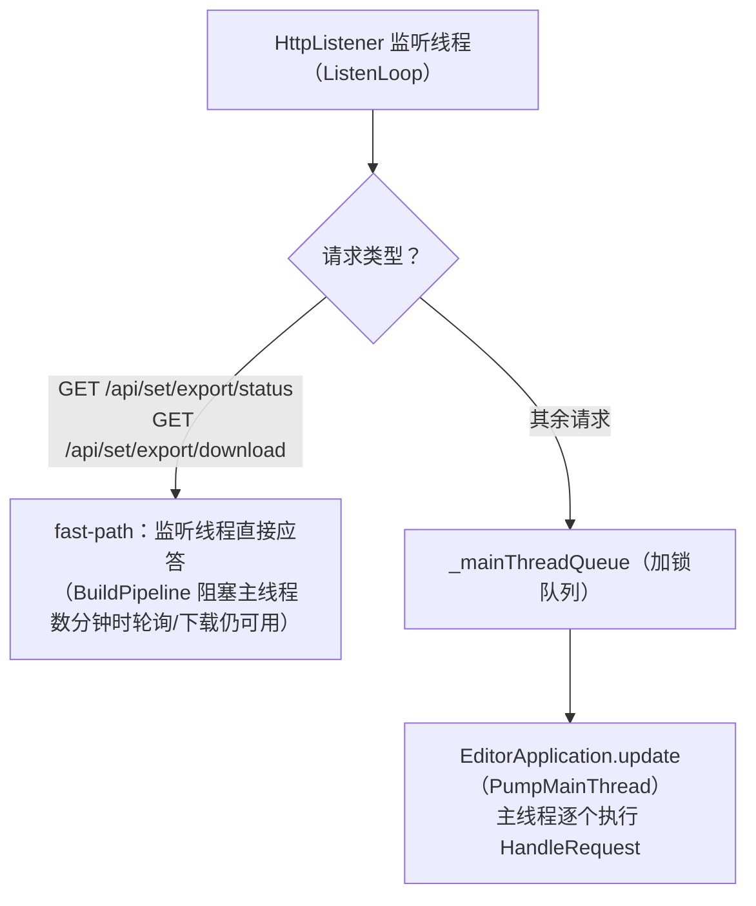
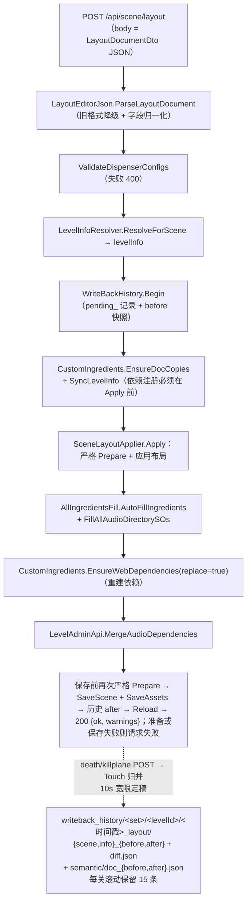
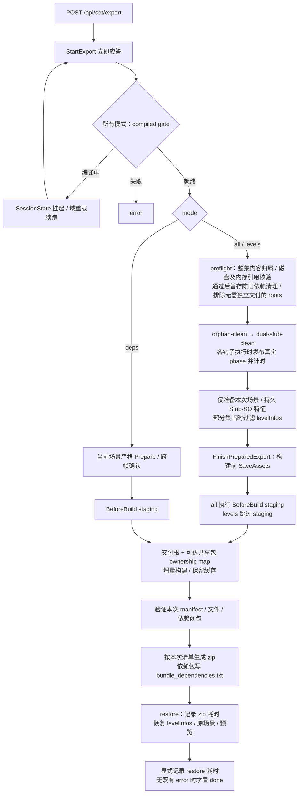

# 02 · 后端 Assets/Editor/LayoutEditor

> 目录：`Assets/Editor/LayoutEditor/`（84 个 .cs，约 42,000 行，Unity Editor 程序集 / .NET 3.5）
> 一句话定位：Unity Editor 插件——在内嵌 HttpListener 上同时提供 **REST API 后端 + Web 前端静态托管**，把浏览器画布数据写回 Unity 场景 / `LevelInfoSO`，并完成 AssetBundle 构建与 zip 导出。
> 返回 [00-架构总览.md](00-架构总览.md)

---

## 1. 完整目录树（所有 .cs，相对 `Assets/Editor/LayoutEditor/`）

```
├── AirFloorRig.cs                        空气地板"岛式"层级 rig 工具
├── AnimGroupBakery.cs                    动画组 → 原生 Animator 烘焙器 (2819 行)
├── AnimGroupBakeryTests.cs               烘焙器 asset key 单测（菜单触发）
├── AnimGroupImporter.cs                  场景动画组 → 文档模型反向导入 (1302 行)
├── PilotGroupBakery.cs                   摇杆操控组 → 原版 PilotMovement 刚体烘焙器（groupKind="pilot"）
├── ButtonEventBakery.cs                  按钮↔事件组联动烘焙
├── ButtonLinkBakery.cs                   按钮↔动画组联动烘焙 (956 行)
├── CoaxialButtonBakery.cs                同轴按钮组烘焙（≥2 按钮时间窗内集齐→目标广播）
├── SpeedControlBakery.cs                 按钮控速/生成器批次烘焙（Design/Speed Logic；3.10.0）
├── RandomTriggerBakery.cs                随机触发器烘焙（信号/按钮输入→按权重随机选一候选发出；3.9.0）
├── RandomTriggerBakeryTests.cs           随机触发器 tag 编解码往返测试（菜单触发）
├── CustomRecipeConfigSO.cs               自定义菜谱配置 SO（LevelEditorStub 命名空间）
├── CustomStubAutoBake.cs                 CustomStub 按需自动化（拷贝/编译/补烘焙闭环）
├── CustomStubCopyTool.cs                 CustomStub 母本 → 关卡集 stub/ 拷贝工具
├── CustomStubHttpApi.cs                  CustomStub web API 桥（钩子注册）
├── CustomStubOrphanRepair.cs             场景孤儿脚本引用修复（文本级 YAML 改写；[InitializeOnLoad] 订阅 OrphanCleanHook，导出前自动安全清理）
├── LayoutEditorAllIngredientsFill.cs     allIngredients / 音频目录自动填充
├── LayoutEditorAudioExporter.cs          游戏音频提取导出（exports/audio/）
├── LayoutEditorBridgeWindow.cs           主 EditorWindow + 服务看门狗 ★入口
├── LayoutEditorBundleDumper.cs           StreamingAssets bundle 全量 dump → dump_bundle/
├── LayoutEditorBurgerApi.cs              汉堡组装工作台后端 (1062 行)
├── LayoutEditorMatchlistMap.cs          DLC → RecipeMatchList 自动映射 (2026-09-15 新增)
├── LayoutEditorCannonPatch.cs            大炮 Play 期运行时补丁
├── LayoutEditorCatalogApi.cs             食材/菜谱目录与关卡菜谱读写 (1134 行)
├── LayoutEditorCatalogLookup.cs          占地尺寸表 + 默认父路径表
├── LayoutEditorCookingUtensilGuard.cs    锅具 stub 自愈守卫/降级工具
├── LayoutEditorCustomIngredients.cs      common03/commonW1/commonW2 依赖注册
├── LayoutEditorDependencyRepair.cs       缺失自定义 bundle 依赖启动修复
├── LayoutEditorDiag.cs                   AssetBundle 加载诊断菜单
├── LayoutEditorDispenserIconFix.cs       食材箱新皮肤图标兼容补丁 (520 行)
├── LayoutEditorFloorMaterialsApi.cs      地板材质目录扫描
├── LayoutEditorFlowStateProbe.cs         Play 期加载状态机探针
├── LayoutEditorFootprintDump.cs          装饰 prefab 实测尺寸批量导出
├── LayoutEditorFootprintMeasure.cs       单实例占地/高度测量
├── LayoutEditorGridReader.cs             QuadGridManager 网格信息读取
├── LayoutEditorGridSnapGuard.cs          解除 EditorGridSnap X/Z 吸附守卫
├── LayoutEditorHierarchy.cs              层级路径 查找/创建
├── LayoutEditorHotPotDiagnostics.cs      火锅链路 Play 期诊断
├── LayoutEditorHotPotFill.cs             火锅大锅许可食材自动登记
├── LayoutEditorHttpServer.cs             HTTP 服务与全部路由 ★核心 (1937 行)
├── LayoutEditorImageExporter.cs          dump_bundle 图片分类导出 → dump_images/
├── LayoutEditorIngredientSprayPatch.cs   奶油喷罐 m_OrderPrefab 运行时补齐
├── LayoutEditorItemSwitcherPatch.cs      饮料机/酱料机多选循环运行时补丁
├── LayoutEditorJson.cs                   JSON 序列化/解析（含降级手写解析）
├── LayoutEditorLanRelay.cs               LAN TCP 中继（Windows 无 URLACL 时）
├── LayoutEditorLevelAdminApi.cs          关卡集/关卡/自定义菜谱管理 ★最大 (4048 行)
├── LayoutEditorLevelInfoResolver.cs      场景 → LevelInfoSO 解析
├── LayoutEditorLevelInfoSanitizer.cs     旧 LevelInfoSO 字段迁移/消毒
├── LayoutEditorLog.cs                    持久日志 + 写回告警收集
├── LayoutEditorManualLookup.cs           中英文名词典查询
├── LayoutEditorModels.cs                 全部 DTO 数据模型 (1675 行)
├── LayoutEditorConsoleLogCapture.cs      Console 常驻日志落盘 logs/console_log.log
├── LayoutEditorPaths.cs                  web dist 路径/URL 帮助
├── LayoutEditorPlayModeLogCapture.cs     Play 日志落盘 logs/
├── LayoutEditorLayoutMigrations.cs       旧关卡一次性迁移（茶杯回收台 returnClean/迁移基线）
├── LayoutEditorPseudoReload.cs           伪预制件重载（Prepare/Reload 工作流）
├── LayoutEditorPushablePotPreview.cs     可移动火锅编辑器预览锅
├── LayoutEditorRecipeKnowledge.cs        菜谱组成知识/烹饪分组计算 (894 行)
├── LayoutEditorRoastTrayFill.cs          烤盘许可食材自动登记
├── LayoutEditorSceneRepair.cs            场景损坏预制件实例清理
├── LayoutEditorSetExporter.cs            关卡集 AssetBundle 构建与 zip 导出 ★
├── LayoutEditorStubIO.cs                 Stub 组件导出/写回核心 (2307 行) ★
├── LayoutEditorSwitchLinkPatch.cs        开关联动运行时补丁（Play 期）
├── LayoutEditorTerminalPatch.cs          控制终端运行时补丁
├── LayoutEditorWorldMapDressingPatch.cs  世界地图装饰展开运行时补丁
├── LayoutEditorWriteBackHistory.cs       写回历史（快照/diff/恢复）(1569 行)
├── LayoutEditorZipWriter.cs              手写 store-only zip 打包器
├── LayoutStubDllBuilder.cs               Stub DLL → .dll.bytes → runtime bundle
├── SceneFloorExporter.cs                 地板/背景面导出
├── SceneLayoutApplier.cs                 文档 → 场景写回核心 (2472 行) ★
├── SceneLayoutExporter.cs                场景 → 文档导出核心
├── SceneWalkabilityReader.cs             可行走矩形 / 死亡配置读取
├── AudioFs/                              —— 纯 C# Unity bundle/FSB5 解析库 ——
│   ├── AudioFsBundle.cs                  UnityFS (2017.4 v6, LZ4) bundle 读取器
│   ├── AudioFsFsb5.cs                    FSB5 解析 + Vorbis→ogg 重组 + ADPCM→wav
│   ├── AudioFsLz4.cs                     LZ4 块解压（decode only）
│   ├── AudioFsSerializedFile.cs          SerializedFile + typetree 动态读取
│   ├── AudioFsTables.cs                  common string / vorbis setup 表加载
│   ├── oc2-common-strings.txt            （数据文件）
│   └── vorbis-setup-tables.txt           （数据文件）
└── CustomStub/                           —— 运行时关卡逻辑"母本"（模板代码）——
    ├── CustomStub.asmdef                 Editor 平台程序集，引用 LevelEditorStub
    ├── core/EntryPoint.cs                运行时安装器（ticker+Harmony+场景自愈）
    ├── core/GameApi.cs                   Assembly-CSharp 反射类型缓存 (736 行)
    ├── core/HarmonyPatches.cs            KillPlane/煮糊阈值 Harmony 补丁
    ├── core/StubLog.cs                   统一日志桥（loader 转发）
    ├── HotPot/HotPot.cs                  火锅运行时管理器
    ├── HotPot/PushablePot.cs             可推动大火锅装配器
    ├── HotPot/PushableVoidFall.cs        可移动火锅坠落/重生 (1148 行)
    ├── HotPot/PushableVoidFallTarget.cs  载具标记组件
    ├── RandomCrate/RandomCrate.cs        随机食材箱运行时组件 (693 行)
    ├── Switch/TimedCookingSwitch.cs      火锅灶台定时开关
    ├── Switch/SwitchReenable.cs          按钮自动复位
    ├── Terminal/TerminalGuard.cs         未绑定终端防线
    ├── Travelator/TravelatorReverser.cs  自动步道定时反转（相位翻转 = 绕 Y 旋转可配置角度）
    ├── UtensilTiming/UtensilTiming.cs    锅具时间运行时应用（含 Harmony 接管）
    ├── UtensilTiming/UtensilTimingConfig.cs 锅具时间配置组件（权威通道）
    └── WorldMap/WorldMapDressing.cs      世界地图装饰强制展开
```

---

## 2. 核心架构

### 2.1 入口与生命周期

```
Unity 启动 / Domain Reload
  └─ [InitializeOnLoad] LayoutEditorServerLifecycle          (LayoutEditorBridgeWindow.cs 尾部)
       └─ EditorApplication.update += WatchdogTick           每 2s 检查一次
            └─ EditorPrefs["LayoutEditor.ServerAutoStart"] 为 true 时
                 确保 LayoutEditorHttpServer 存活（限流：60s 内最多 5 次重启，间隔 ≥2s）
```

- **主窗口**：`LayoutEditorBridgeWindow : EditorWindow`（菜单 `Layout Editor/打开桥接窗口 (Open Bridge)`）：启动/停止服务、打开浏览器编排页（`/layout?scene=<当前场景>`）、四个导出按钮（装饰尺寸/音频/Bundle dump/素材图）、两个 CustomStub 按钮（反射软调用，扩展缺失时置灰不报错）。
- **HTTP 服务**：`LayoutEditorHttpServer`（普通 C# 类，非 MonoBehaviour）。

### 2.2 通信机制（HTTP，端口 8765）

| 项 | 值 |
|---|---|
| 协议 | 纯 `System.Net.HttpListener`（无 WebSocket） |
| 默认端口 | **8765**（`DefaultPort`） |
| 绑定 | 优先 `http://*:8765/`（+ localhost）；Windows 非管理员绑定失败 → 回退仅 `127.0.0.1`，并自动起 `LayoutEditorLanRelay`：`0.0.0.0:8766 → 127.0.0.1:8765` 原始 TCP 字节中继（不走 HTTP.sys，无需 URLACL） |
| 重试 | 端口占用时 5 次 × 500ms |
| CORS | `*`（GET/POST/OPTIONS），OPTIONS 直答 204 |
| 前端托管 | `layout-editor/web/dist`（`LayoutEditorPaths.WebDistRoot`）；SPA 子路由回退 `index.html`，`/recipes` → `recipes.html`，`/index.html` 302 → `/` |
| 主页 | `http://127.0.0.1:8765/manage`；编排页 `/layout?scene=...` |

### 2.3 线程模型



- `_responseSent` 标志防止重复写响应；异常兜底为 500 JSON。
- `/api/compile`（触发 `AssetDatabase.Refresh`）会因域重载截断连接，属预期，看门狗负责拉起。

### 2.4 API 路由总表（`LayoutEditorHttpServer.HandleRequest`）

**健康/环境**
| 路由 | 说明 |
|---|---|
| `GET /api/health` | ok/port/static/schemaVersion(=5)/knowledgeLoaded/dictionaryLoaded |
| `GET /api/env/status` | 静态前端、exports/audio·decor·counter-skins、StreamingAssets/Windows 游戏包数量、dump_bundle/manifest.json 存在性 |

**场景画布（核心读写）**
| 路由 | 说明 |
|---|---|
| `GET /api/scene/layout?assetPath=` | 打开场景并导出 `LayoutDocumentDto`（物品/地板/可行走/死亡/动画组/开关联动/按钮联动/相机/灯光） |
| `POST /api/scene/layout?snap=0.01&syncWalkable=1&only=items\|decor\|floors` | **写回**（§4 详述） |
| `POST /api/scene/repair-broken?assetPath=` | 清理损坏预制件实例 |
| `POST /api/scene/death` / `POST /api/scene/killplane` | 死亡主题 / KillPlane 边界（归并进写回历史） |
| `GET /api/grid` | QuadGridManager 网格信息 |

**目录（catalog）**
| 路由 | 说明 |
|---|---|
| `GET /api/catalog/ingredients` / `floor-materials` / `questionmarks` / `questionmarks/icon` / `music` / `audio-directories` / `ambiences` / `death-effects` | 各类目录扫描 |
| `GET /api/recipes?levelSet=`、`GET/POST /api/level-recipes` | 关卡菜谱读写 |
| `GET /api/level/optional-presets`、`POST /api/level/optional-items`、`POST /api/level/matchlists`、`GET /api/level/matchlists/suggest`、`POST /api/recipes/compute-burger-optionals`、`POST /api/recipes/compute-pizza-optionals`、`GET /api/level/burger-optional` | 可选部件/匹配表（🍕 compute-pizza-optionals：按所选披萨生成/更新 `data/{关卡}/PizzaOptional_{Uncooked,Cooked}.asset`，浇头=原版5种∪所选披萨配料，修橄榄无法上面坯） |

**原味松饼煎锅补全**：`LayoutEditorPancakeFill` 仅在已选菜谱含原版 `PseudoPrefabSORecipe`、资产文件名精确为 `Cake_Plain_SO` 时启用。现有 `POST /api/level-recipes` 同步绑定该 LevelInfo 的已加载场景；场景打开/重载、写回和导出准备同样兜底。只处理场景内原版 `FryPanSO`（含 inactive，排除 manager 环境物件），幂等追加 commonW5 `Web_MixedFlourEgg`，保留已有许可项与模型槽位，仅将非正容量补为 1；依赖通过常规存在性闸门登记 `commonW5`/`bundle18`。空许可表代表完整原生 lookup：混选其他煎锅菜、嵌套、自定义或知识缺失等输入未核验菜谱时，保留空表/未配置锅并告警，避免收窄为单一面糊。完整混选装填走前端「按菜谱自动填充」。菜谱保存仅标脏受影响场景，仍需场景写回落盘；用场景布局读回 `cookingUtensil.allowedIngredientGuids` 核对。

**关卡集/关卡管理**
| 路由 | 说明 |
|---|---|
| `GET /api/sets`、`GET /api/sets/<set>/levels` | 列表 |
| `GET /api/sets/<set>/resource-stats` | 每关依赖资源统计（关卡列表徽标/汇总条）：`ScanResourceUsage` 免开场景，扫场景 `.unity` 文本全部 guid 引用（prefab/SO/材质等直接引用）+ `LevelInfoSO` 菜谱/食材/烹饪步骤/匹配表 SO 引用闭包（`CustomRecipeSO` 递归下钻），按来源库分组去重计数（common01-04 / common / commonW1…N / custom=本集 custom_content / other=内置；本集其余资产不算依赖）。返回 `{levels[{assetPath, libs[{library, distinctAssets}]}], summary[{library, distinctAssets(整集并集), levelCount}]}`，库排序 common01-04→common→commonW1…N→custom→other |
| `POST /api/set/create \| info \| delete \| export` | 关卡集操作 |
| `GET /api/set/export/status`、`GET /api/set/export/download?setName&fileName` | 导出状态/下载（fast-path） |
| `GET /api/set/export/deps-manifest` | 依赖包清单（deps 导出弹窗展示用）：逐条目存在性/大小 + 运行时 dllState + 上次打包版本（`BuildDepsManifest`，只读文件系统） |
| `GET /api/set/stub/status`、`POST /api/set/stub/copy \| compile` | CustomStub 状态/拷贝/编译（经 `CustomStubApi` 钩子，未安装 501） |
| `GET /api/level`、`GET /api/level/bundles`（依赖分析）、`GET /api/level/delete-preview`、`POST /api/level/delete-preview-batch` | 关卡查询/删除预览（批量预览 body `{setName, levelIds}` → `{levels:[{levelId, paths}]}`，按关卡分组） |
| `POST /api/level/create \| info \| config \| audio \| delete \| delete-batch \| reorder \| rename` | 关卡操作（create 起 sceneName=levelId 不再加 s_ 前缀；rename 以 newSceneName 为场景文件 / sceneName / bundle 后缀，可保留 s_。目录：场景原本是 s_+目录或等于目录时，新目录去掉一层 s_；否则目录不动。旧 bundle 名若已无资产则删除。delete-batch body `{setName, levelIds}`：先全量校验，任一关卡不存在则不删任何文件；统一删场景 + `data/<level>`、LevelSetInfo 只剔除成功删除条目、末尾仅一次 SaveAssets/Refresh/ReloadPseudo；当前打开场景在待删批内时先切到批外场景） |
| `POST /api/level/image-upload`（贴图地板）、`POST /api/level/screenshot-upload`、`POST /api/level/screenshot-capture`（当前 Unity 场景游戏相机渲染为 JPEG base64）、`GET /api/level/data-file` | 上传/预览 |
| `POST /api/level/summary-bg-upload`、`POST /api/level/summary-bg-clear` | 汇总页导出背景图：写进关卡 data 目录的 `summary_bg~/bg.*` + `meta.json{dim}`。`~` 结尾目录 Unity 完全忽略 → 不被关卡集 folder 级 `assetBundleName`（`<set>/info_<set>`）打进玩家分发包，但随 git 跟关卡版本管理；读取复用 `GET /api/level/data-file`。空 fileName/base64 = 只改遮罩浓度 |
| `GET /api/level/assignment?assetPath=`、`POST /api/level/assignment-save \| assignment-clear` | 菜谱分工配置：读写关卡 data 目录 `assignment~/assignment.json`（2p/3p/4p 三套玩家→菜谱 guid 列表）。后端不解析 JSON 内部结构（前端唯一读写方），只做 LevelSets 路径守卫 + `{` 开头轻校验 + 512KB 上限；同 `~` 目录范式不进 AssetBundle |
| `GET /api/level/order-sequence?assetPath=`、`POST /api/level/order-sequence-save \| order-sequence-clear` | 订单顺序配置（4.0.0.18，原 4.7.0）：读写关卡 data 目录 `order_seq~/order_seq.json`。结构与 assignment 不同——**后端解析并校验**（`OrderSequenceConfigDto`：enabled/endBehavior(loop\|pingpong\|stop)/groups[].{mode(0按序\|1随机), batchSize(抽菜数,0=整池,≤999), recipeGuids[]}；guid 必须可解析为 PseudoPrefabSORecipe/CustomRecipeSO）。场景载体由写回/导出时 `LayoutEditorOrderSequenceBake` 幂等烘焙（见 §Bakery），API 本身不动场景 |
| `GET /api/level/readme?assetPath=`、`POST /api/level/readme-save \| readme-clear` | 汇总页 readme 说明：读写 `readme~/readme.json`（`{schemaVersion, html}`，白名单净化 HTML 仅文字排版，净化在前端 richText.ts）。256KB 上限；同 `~` 目录范式不进 AssetBundle |
| `GET /api/level/group?assetPath=`、`POST /api/level/group-save` | 关卡分组（4.0.0.19，原 4.8.0）：读写每关 `group~/group.json`（`{schemaVersion, group}`，仅存组名；"" = 未分组即删除目录）。`group-save` body `{setName, items:[{levelId, assetPath, group}]}` 批量写（前端只传变更项）；16KB 上限；同 `~` 目录范式不进 AssetBundle。`ScanLevels` 已顺带把组名填进 `LevelSummaryDto.group`（列表一次带回，免 N 次请求）。接口本身只改 group.json；「分组看板」保存时由前端按分区阅读序调用 `/api/level/reorder` 写回 `levelInfos`（分组即分区排序） |

**自定义菜谱 / 汉堡工作台**
| 路由 | 说明 |
|---|---|
| `GET/POST /api/custom-recipes*` | config、list、debug-scan、references、diagnose、create、update、delete、upload-icon、upload-model、category/* |
| `GET /api/custom-recipes/optimize-usage?setName=`、`POST /api/custom-recipes/optimize` | 资产瘦身（📦）：本集 custom_recipes 贴图/模型导入参数概览与一键调整（只改 .meta，详见 §3.5 LayoutEditorCustomRecipeOptimizeApi） |
| `GET /api/custom-recipes/model-files`、`GET /api/custom-recipes/model-files/<b64目录>/<文件>` | 3D 预览文件服务 |
| `GET /api/burger/definitions`（含 `includeModelless`）、`POST /api/burger/create`、`POST /api/burger/definition/update` | 汉堡工作台 |
| `GET /api/custom-recipes/model-templates` | 内置模板网格列表（零建模做夹心模型） |

**写回历史 / 媒体 / 杂项**
| 路由 | 说明 |
|---|---|
| `GET /api/writeback/history \| /detail \| /doc?side=before\|after` | 写回历史查询/恢复 |
| `GET /api/audio/exports`（manifest）、`GET /api/audio/stream?path=`（支持 HTTP Range） | 音频（`exports/audio/`） |
| `GET /api/web-assets/manifest` | Web 导出聚合清单（audio / counter-skins / decor / food-icons 可用性与数量） |
| `GET /api/web-assets/decor/manifest.json`、`GET /api/web-assets/decor/front\|back/<guid>.png`、`GET /api/web-assets/decor/detail/front\|back/<guid>.png`、`GET /api/web-assets/decor/models/<guid>/model.obj\|mtl` | 装饰正/背缩略图 + 高清详情图 + 3D 模型（`exports/decor/`，监听线程 fast-path） |
| `GET /api/web-assets/food-icons/manifest.json`、`GET /api/web-assets/food-icons/recipes/<id>.png`、`GET /api/web-assets/food-icons/ingredients/<id>.png` | 菜谱/食材订单图标原图（`exports/food-icons/`，不放大；监听线程 fast-path） |
| `GET /api/counter-skins/icon/<file>.png`、`GET /api/counter-skins/icons/manifest.json` | 桌台皮肤图标（`exports/counter-skins/icons/`） |
| `GET /api/counter-skins/3d/<name>` | 桌台皮肤俯视图/OBJ/MTL（`exports/counter-skins/`，监听线程 fast-path） |
| `POST /api/web-assets/export`、`GET /api/web-assets/export/status` | 一键导出 Web 资源（body：`{ force, categories }`；状态监听线程 fast-path） |
| `GET /api/level/music/custom?set=`、`POST /api/level/music/custom/upload?set=&file=`（octet-stream，≤20MB）、`POST /api/level/music/custom/delete`、`GET /api/level/music/custom/stream?set=&file=`（Range） | 自定义 BGM：落盘 `Assets/LevelSets/<set>/data/bgm/*.ogg|.wav`，AudioImporter 配 Vorbis/Streaming，显式挂 `<set>/info_<set>` bundle，`LevelInfoSO.inLevelMusic` 直引（LevelAdminApi.ListCustomMusic/SaveCustomMusic/DeleteCustomMusic） |
| `GET /api/icons/status`、`GET /api/web-recipes`、`POST /api/web-recipes/install\|uninstall`（废弃）、`POST /api/reload`、`POST /api/compile` | 杂项 |

### 2.5 静态解耦钩子（可选扩展点，删文件仍可编译）

| 钩子 | 定义处 | 订阅方 |
|---|---|---|
| `LayoutEditorHttpServer.CustomStubApi : Func<action,set,json>` | HttpServer | `CustomStubHttpApi`（[InitializeOnLoad]） |
| `LayoutEditorStubIO.CustomStubCopyRequested : Action<string>` | StubIO | `CustomStubAutoBake`（自动拷贝母本） |
| `LayoutEditorSetExporter.BeforeBuild : Action<string>` | SetExporter | `LayoutStubDllBuilder`（导出前打包统一运行时 DLL） |
| `LayoutEditorSetExporter.RuntimeReadyGate : Func<string>` | SetExporter | `LayoutStubDllBuilder`（导出启动闸口：null=就绪 / "compiling"=已触发自动编译→任务 SessionState 挂起、域重载后 SetExporter 自动续跑 / 其他=失败原因） |
| `LayoutEditorSetExporter.RuntimeStageState : Func<string>` | SetExporter | `LayoutStubDllBuilder`（deps 清单的运行时 dllState） |
| `LayoutEditorSetExporter.OrphanCleanHook : Func<List<string>,string>` | SetExporter | `CustomStubOrphanRepair`（导出 prepare 前对本次场景自动清孤儿脚本引用；仅报告项不阻断） |
| `LayoutEditorDispenserIconFix.AfterRandomCrateSync : Action` | DispenserIconFix | `CustomStubAutoBake`（问号图标补画） |

---

## 3. 逐文件详细说明

### 3.1 服务与窗口

| 文件 | 详细说明 |
|---|---|
| **LayoutEditorBridgeWindow.cs** | 主 EditorWindow。类 `LayoutEditorBridgeWindow` + `LayoutEditorServerLifecycle`（[InitializeOnLoad]）。`OpenWindow/StartServerMenu/StopServerMenu`（菜单）、`WatchdogTick()`（2s 周期保活 + 限流重启）、`OnGUI`（服务控制/URL/导出按钮/CustomStub 反射软调用）。持有静态单例 `_server`；`EditorPrefs` 记录自动保活意图跨域重载存活 |
| **LayoutEditorHttpServer.cs** | 后端心脏。`Start(port=8765)`（通配→本机绑定回退→LanRelay）、`Stop()`、`ListenLoop/EnqueueMain/PumpMainThread`（主线程泵）、`TryServeExportFastPath`、`HandleRequest`（§2.4 全部路由分发）、`TryServeStatic`（SPA 静态 + 路径穿越防护）、`ValidateDispenserConfigs`（写回强校验：普通箱必须 1 种食材、随机箱 ≥2 候选）、`LogExportDiagnostics/LogDispenserTrace`、`BuildEnvStatus`、`ServeAudioExports/ServeAudioStream`（Range 分支）、`ServeIconsStatus` |
| **LayoutEditorLanRelay.cs** | `Start(relayPort, targetPort)` 在 0.0.0.0 监听 TcpListener，每连接双向线程泵字节转发（`Pump` 半关闭处理）。仅 HttpListener 通配绑定失败时自动启动 |
| **LayoutEditorPaths.cs** | `WebDistRoot`（`<repo>/layout-editor/web/dist`）、`IsWebDistReady`、`WebUiUrl`、`WebUiUrlForActiveScene`、`IsPathUnderRoot`（路径穿越防护） |
| **LayoutEditorJson.cs** | `ToJson`（JsonUtility + 基础类型手写 + NaN/Inf 消毒）、`ParseLayoutDocument`（JsonUtility → 失败时 `ParseLayoutDocumentLegacy` 手写扫描 items 数组；null 字段/footprint 归一化补全） |
| **LayoutEditorLog.cs** | 持久日志到 `<repo>/logs/layout_editor.log`；写回告警通道 `BeginApply/RecordApplyWarning/DrainApplyWarnings`（≤50 条，写回响应透传给 web 状态栏） |
| **LayoutEditorModels.cs** | 全部 DTO：`LayoutDocumentDto`（items/floors/walkable/deathInfo/animControls(旧键 moveControls)/switchLinks/buttonLinks/buttonEvents/cameraInfo/lights）、`LayoutItemDto` + 约 20 种 stub 子 DTO、`FloorDto`（tint/image/warp/airFloor/pbr：`pbrOverride/metallic/smoothness`；渲染模式：`renderModeOverride/renderMode` 0..3）、`AnimGroupDto` 系列、`LevelSet*/Level*/PerPlayerConfig/AudioConfig`、bundle 分析、自定义菜谱/汉堡全套、写回状态、`EnvStatusDto` |

### 3.2 场景导出（场景 → 文档）

| 文件 | 详细说明 |
|---|---|
| **SceneLayoutExporter.cs** | `ExportActiveScene()` 组装完整文档：遍历 `Design/Art/Chefs` 三根（跳过 `Design/Collision` 子树与 `LevelEditorStub.Stub` 子孙）收集 prefab 实例根 → `LayoutItemDto`（`LayoutEditorStubIO.ExportStub` 填 stub 数据）；`ResolveFootprint`（目录覆写优先 → Art/ 装饰 renderer 实测 → 1×1 兜底）；`CollectCollisionObjects`（非 prefab 纯 BoxCollider 按 **1.132 魔法数**识别空气墙）；`CollectSwitchLinks`；相机/灯光收集；动画组/按钮联动导入。常量 `AirWallCatalogGuid` |
| **SceneFloorExporter.cs** | 收集非 prefab 的内置 Plane/Quad（mesh fileID 10209/10210）与内嵌 warp 网格（`ImgWarpFloorMesh` 前缀）地板 → `FloorDto`；`TryAddAirFloor`（按名 `Col_AirFloor` + Ground 层识别，含去重）；图片地板状态从 GameObject 名（`imgfloor|path|mode|opacity[|rot]`）解码；tint 从名 `#rrggbb` 解码；PBR 覆盖从变体材质名尾段 `_m<0-100>_s<0-100>`（可叠 `_tilingWxH` 后）解码为 `pbrOverride/metallic/smoothness`，渲染模式从 `_rm<0-3>` 段解码为 `renderModeOverride/renderMode`；未覆盖时读材质 `_Metallic/_Glossiness/_Mode` 作展示基线；材质名 → surfaceKind 推断 |
| **SceneWalkabilityReader.cs** | 只读层：`ReadWalkable()`（Ground 层 BoxCollider → `WalkableRectDto`，PlayerPhysicsSurface → ice）；`ReadDeathInfo()/ReadKillPlanes()`（优先 PseudoPrefabManagerStub.levelInfo.onDeathEffectSO，回退 GameSession；RespawnCollider → respawnType + bounds；死亡类型按特效 guid 分类 water/goo/fall） |
| **LayoutEditorGridReader.cs** | 反射读 `QuadGridManager` 的 m_gridHalfSize/m_size/m_origin → `GridInfoDto` |
| **LayoutEditorHierarchy.cs** | `GetHierarchyPath`、`FindByPath`（逐级查找 + 同名兄弟兜底）、`FindOrCreatePath` |

### 3.3 场景写回（文档 → 场景）

| 文件 | 详细说明 |
|---|---|
| **SceneLayoutApplier.cs** | `Apply(document, snapStep, syncWalkable, only)` 全流程：①`PruneThemeBackgroundItems` 去重 → ②`PrepareSceneForApply` → ③before 快照 + 删除未匹配物品 → ④首轮：空气墙（BoxCollider 1.2×1.132×1.2）、防堆叠守卫、`new:` 前缀 → `PrefabUtility.InstantiatePrefab + FindOrCreatePath + ApplyStub`，既有 → 变换更新 + ApplyStub → ⑤二轮：`ApplyTeleportalExit/ApplyServingStationPlateReturns/ApplyTerminalPilotable/ApplyHeatedOvenHeatSource/ApplySwitchLinks/BakeWorldMapDressing` → ⑥`ApplyFloors`（图片/tint/材质**烘焙进材质实例**而非 MPB；材质地板覆盖段在 `BakedMaterialFloorMaterial` 烘焙为 `<base>[_tilingWxH][_rm#][_m##_s##].mat` 变体资产——PBR `pbrOverride/metallic/smoothness` SetFloat `_Metallic/_Glossiness`，渲染模式 `renderModeOverride/renderMode` 走 `ApplyStandardRenderMode` 四态配方（_Mode/_SrcBlend/_DstBlend/_ZWrite/alpha 关键字/RenderType/渲染队列，0=Opaque 1=Cutout 2=Fade 3=Transparent）；源为 legacy shader 时换内置 Standard 重建并 `CopyFloorMaterialSurface` 拷贴图/颜色，commonW1/W2 约半地板材质属此类）；warp 透视网格按相机反投影；`SyncWalkableToFloors` 重建 Col_Floor，静态地面挂 `ObjectContainer`）→ ⑦相机/灯光全量（`ApplyCameraInfo`：背景色/FOV 写 Camera 组件；出发点位置 X/Z 写 **MultiplayerCamera 所在根节点**而非 Camera.main 子物体——子物体 Animator（Camera.controller）运行时把 localPosition 钉在 0，写子物体会被抹掉；顺带清零子物体 localPosition 清除旧版残留偏移；X/Z 实际变化时经 `LayoutEditorStubIO.SetCameraOffsetTag` 给根节点烘焙 `CameraOffset|<x>,<z>` 载体 tag——CustomStub.CameraAuthoredOffset 按需补丁的门票（编辑器 Play 与真机同路径），无 tag 的图零影响） → ⑧动画烘焙链（ButtonLinkBakery.PrepareGroups → **PilotGroupBakery.Sync**（摇杆组，先于动画组做冲突消解） → AnimGroupBakery.Sync → ButtonLinkBakery.Sync → ButtonEventBakery.Sync → AutoEnableDynamicParenting）→ ⑧.5 分 P 收尾后 `LayoutEditorStubIO.ApplySwitchTint/CleanupSwitchTintHelpers` 按最终路径重建 `Design/Switch Tint Logic` 调色 helper（`CustomStub.SwitchTint` + `SwitchTint|T:…|I:…|P:…` tag；颜色仅存 helper，不改原材质）→ ⑨`EnsurePrepareForBuilding → MarkSceneDirty → SaveScene → SupplySemanticAfter → ReloadPseudoAssetsFull → GridSnapGuard.RelaxGridSnapOnScene`。<br>**多镜头分屏**：`CameraInfoDto.splitScreen` + `splitScreenCameras[]`（visible/offset/FOV/size）随全量写回；`ApplyCameraInfo` 把 `SplitScreen|2|C0:...|C1:...` 载体 tag 优先挂在 **Camera 子物体**（避免与根节点 `CameraOffset|` 共用同一 `SpecificPseudoPrefabTag` 互相覆盖），并清理旧版落在根节点的同名 tag。`CollectCameraInfo` 同时检查 Camera 子物体与相机根节点并解析 `C0..C3` 每镜头参考；`LayoutEditorSetExporter.CustomStubTagPrefixes` 收录 `SplitScreen|`（特征 `camera`）。**进场动画**（`CameraIntroBakery.cs`）：`CameraInfoDto.intro`（mode/duration/startDistance/rotateAngle/focusTarget）随全量写回；自定义模式烘焙 clip（Camera 子物体 localPosition+localRotation 四元数曲线）+ 两态 controller（Intro→Idle 常持）整替 Animator，参数 JSON 嵌 controller 的 `IntroSource` 子资产往返；vanilla/raft/space 切回官方 controller 并清理烘焙资产、none 禁用 Animator；`intro=null` 写回不动。资产在 `GetAnimationsFolder`/`cameraintro_<scene>.*`，零新 tag/特征。 |
| **LayoutEditorStubIO.cs** | stub 数据层（最复杂的防御性代码）。`ExportStub(go,item)`：按组件类型导出 Player/ServingStation/Dispenser（含随机箱）/AttachingFoodSpawner/Conveyor/Teleportal/CookingUtensil（含 UtensilTiming 反射读取）/Travelator/Flamethrower/PlateReturn/CleanPlateStack/Burner/Switch/PressureSwitch/Terminal/HeatedOven/Cannon/MeshWithMaterial/SOArray/通用 guid/TimedCookingSwitch。`ApplyStub(go,item)`：写回各分支；防 NRE 降级（`CookingUtensilGuard.DowngradeToBase`）；wrapper 补挂派生 stub + 派生运行时组件；**数组字段必须走 SerializedObject**（Unity 2017 prefab 实例数组收缩残留根治）；`ResolveRefObject`（createdObjects 优先、InstanceID 兜底——绑定丢失主根因修复）；**回收台堆 SO**：`EnsurePlateReturnStackSOs` 按回收台 **prefab 资产名**（不能只看 stub SO 的原版子 prefab 名）推断脏/净堆（餐盘回收台 `dlc08_workstation_tray_return` → `dlc08_dirtytraystack`/`dlc08_cleantraystack`，不可与普通 `dirtyplatestack` 混用，否则上菜后脏餐盘会错回脏盘台；茶杯回收台 `web_teacup_return` → `web_teacup_stack_dirty`/`web_teacup_stack_clean`）；错配时写回覆盖并 `WarnApply`。`PromoteDerivedStub` 会继承基础 stub 的 `pseudoPrefabSO`、补派生运行时（`PseudoPrefabPlateReturn` 等），`PromoteAllDerivedStubsInScene` 在写回重载/场景打开/导出前批量修复“有派生 stub 无运行时”的旧场景；反之上菜台绑定会丢弃缺运行时的目标，避免 `PseudoPrefabServingStation.LateSetup` NRE。旧关卡茶杯回收台 `returnClean=true` 的一次性迁移由 `LayoutEditorLayoutMigrations` 负责（sidecar `layout_migrations~`，SaveScene 成功后才落标记）。随机食材箱 `ExportRandomCrate/ApplyRandomCrate/WriteRandomCrateData`（组件权威 + `PseudoPrefabSOArray` 候选 + `SpecificPseudoPrefabTag` tag `RandomCrate|<iconGuid>|w1,w2,...` 双通道）/`EnsureRandomCrateDependencies`（bundle 必须存在于 StreamingAssets 才注册）/`RebakeRandomCratesInActiveScene`（域重载后自愈）；`FindCustomStubType(setName, className)` 反射找 `CustomStub.<class>`；静态钩子 `CustomStubCopyRequested`；`ApplySwitchTint/CleanupSwitchTintHelpers/SwitchTintCache`：开关/压力地板调色 helper（`CustomStub.SwitchTint` 组件 + `SwitchTint|T:路径|I:未按下色|P:按下色` tag；组件优先、tag 回落）；`RefreshStubTagsInActiveScene` 含 `OrderSeq|` 重打（组件为权威，见 LayoutEditorOrderSequenceBake） |
| **LayoutEditorOrderSequenceBake.cs** | 订单顺序烘焙（4.0.0.18，原 4.7.0）：`order_seq~/order_seq.json`（权威配置，前端菜谱管理「订单顺序」tab 编辑）→ 场景载体，挂在 **PseudoPrefabManagerStub 所在物体**（关卡级配置锚点）：`CustomStub.OrderSequenceSettings` 组件（反射软接入，字段 endBehavior/groupModes/groupSizes/groupBatches/**recipeUids**）+ `OrderSeq\|e=…\|m=…\|s=…\|b=…\|u=…` tag（全标量）。**菜谱引用编码为 OrderDefinitionNode uID**（`RecipeHelper.GetOrderDefinitionNode(so).m_uID`：PseudoPrefabSORecipe=bundle 资产固有 uID、CustomRecipeSO=SO.uID）——运行时 `OrderSequenceDirector` 按 uID 在关卡 RecipeList 解析 Entry，与编辑器 LevelConfigSetup / 真机 OC2DIYLevel 两条构建链同源，场景零 SO 引用、tag 可无损自愈。`ApplyForOpenScene(info)` 幂等（禁用/缺失/无有效组 → `RemoveFromScene` 清理组件+tag）；调用点=SceneLayoutApplier 写回（SaveScene 前）+ SetExporter 导出 prepare（`CollectActiveSceneStubFeatures` 前，特征 `orderseq` 靠载体识别）；失效 guid 跳过并告警（整组失效跳组） |
| **AirFloorRig.cs** | 空气地板动画"岛式"层级（`AirFloor(ObjectContainer)/Ground(BoxCollider)`）：`IsColliderObject/IsWrapperName/GetAnimatedMember/EnsureRig`。被 SceneLayoutApplier/SceneFloorExporter/AnimGroupBakery 共用 |
| **LayoutEditorPseudoReload.cs** | 伪预制件生命周期适配层：`LayoutEditorSceneCleanup`（sceneClosing 清理）、`EnsurePrepareForBuilding`、`ReloadPseudoAssets`（轻量）、`ReloadPseudoAssetsFull`（DeInit+Init+Sanitize+预载 bundle+补种子+重试）、`EnsureCustomBundleDependency`。所有写回/管理端点的"保存后刷新"统一走这里；写回/场景打开/导出前会调用 `PromoteAllDerivedStubsInScene` 修半损派生运行时 |
| **LayoutEditorLayoutMigrations.cs** | 关卡级一次性迁移：旧关卡 `web_teacup_return.returnClean=true` → false，标记落 `data/<level>/layout_migrations~/layout_migrations.json`。`MarkLevelCreated` 在 CreateLevel 时写基线（新关卡手动勾选干净杯不被误迁移）；`ApplyBeforeWriteBack` 只迁移旧实例（`u:`）并延后到 SaveScene 后 `CommitPending`；`ApplyToOpenScene` 供场景打开/导出 prepare 兜底 |

### 3.4 动画与按钮烘焙

| 文件 | 详细说明 |
|---|---|
| **AnimGroupBakery.cs** | 把 `AnimControlDataDto` 烘焙为**与原版关卡同构**的原生动画：`Design/Animated Objects/<组名>` 根 + Animator + 游戏的 TriggerQueue/TriggerTimer + `Assets/LevelSets/<set>/data/<level>/animations/` 下 controller/clips 资产。`Sync → BakeGroup`（成员 re-parent、`BuildTimeline/MigrateEventTimeline`（旧 delay 链 → startTime 时间轴）、`BuildClusters`（时间重叠事件并行合并组合 clip）、`BuildMoveClip/BuildRotateClip/BuildWaitClip`（loop/pingpong/lift/drop/相位错位）、`BuildScaleClip`（m_LocalScale 三曲线，scaleTo 倍率：0=缩到 0 消失/>1=放大，loop 脉冲/pingpong 呼吸）、`BuildFadeClip`（fade 淡入淡出：动画 CustomStub.FadeDriver.alpha 字段（曲线绑定字符串类型名 "FadeDriver"），组件运行时把 alpha 写入成员子树 Renderer 材质——真模型是运行时实例化的 bundle child 无法直接绑材质；fadeTo 0=隐身/1=显型，loop 闪烁；含 fade 事件的组成员反射挂载 `AttachFadeDriver`，真机端 EntryPoint.HealScene `HealFadeDrivers` 幂等补挂（场景序列化件 Missing Script 同 AnimGridMemberSync 教训））、`BuildTiltClip`（绕自身 X/Z 轴翻转 ±180°，pingpong=往返摆动/缓慢晃动；rotate+tilt 同簇经 `ComposeRot`/`WriteRotationKeyList` 统一四元数键合成，固定 baseRot·Y·X·Z 顺序防互相覆盖）、`BuildOrbitClip`（每成员绕共享圆心 `orbitCenterX/Z` 公转，半径=初始位到圆心距离 per-member，loop=持续公转；与 move/其他 orbit XZ 互斥校验，与 lift/drop 可同簇）、`BuildController`（全触发驱动状态机；`advanceMode="hold"` 走 `BuildHoldController`：Closed→Open→Idle_Open→Close→Closed，压力开关 Enter/Exit 直连）、`CleanupStale`）；事件级 `easing`（linear/easeIn/easeOut/easeInOut/easeOutBounce/easeInOutBack，`EaseValue` 与 web `easeValue` 同名同公式）作用于 move 路线（`SampleRouteKeys` 采样层，waypoint 级 `ctrlHas/ctrlX/ctrlZ` 二次贝塞尔控制点）、scale/lift/drop/rotate/tilt/orbit 进度；orbit 折叠 `memberHoldPos`（per-member 末位置，后续 wait/纯Y 定持不闪回）；纯旋转/等待组也会补成员 `hierarchyPath`，保证 `AnimGroupSource` 无损回读；`BakeFxGroup`（shake=相机 rig `FX_CameraShake`、flash=`Lights/FX_Lightning` + 雷声）；`PersistAuthoringSource`（原始编排 JSON 作为 `AnimGroupSource` TextAsset 子资产嵌入 controller，无损回读——scale/tilt/orbit 的唯一保真路径，片段分析不认识新类型）；asset key 生成（`BuildAssetKey/ShortHash`） |
| **AnimGroupImporter.cs** | `ImportFromScene`：扫描场景候选（TriggerQueue/TriggerTimer + Animator 含 Transform 曲线）→ `TryImportFromSource`（优先反序列化嵌入 AnimGroupSource）→ 回退片段分析（路线/相位匹配/静态成员/lift 剖面提取）。只有形状平行的成员才保证再烘焙保真 |
| **ButtonLinkBakery.cs** | 按钮/压力开关 → 动画组联动，烘焙到 `Design/Button Logic/Btn(Logic|Pair)_*`：顺序触发状态环（Ready_i→Run_i→Ready_{i+1}）、lockUntilFinished（ClearTriggerDuringState）、互锁对 AND 门（pairId，每方 ≤4 组；共享环多组完成门只听第一个 BLDone）；压力开关的 `advanceMode="hold"` 组走 helper-less 直连：`triggerOnAnimatorEnter/Exit` 写组根 Animator 的开门/关门触发器，回导时从压力开关 stub 重建 buttonLink；`PrepareGroups/Sync/ImportFromScene/CleanupStale` |
| **ButtonEventBakery.cs** | 按钮 → 事件组联动（事件 = 向目标广播 trigger + doneTrigger 完成信号），烘焙到 `Design/Button Event Logic`，按压触发名 `BEP_<helper>` |
| **CameraIntroBakery.cs** | 进场动画（`CameraInfoDto.intro`，11 种模式）：vanilla 恢复原版 Camera.controller 并清理 `cameraintro_<scene>.*`；none 禁用 Camera 子物体 Animator；pullBack/rotateLeft/rotateRight/focus/tour/dollyIn/dive/orbit 烘焙自定义 clip —— `BakeCustom` 按模式构造**路点序列**（首=起始位姿、末=最终位姿：pullBack 沿视轴贴近 / rotate 偏航起始 / focus 全向水平平移到目标 XZ / tour 仅 X 平移 A→B→归位 / dollyIn 视轴远端 / dive 更高更远 / orbit 圆弧 `offset(θ)=R·(sinθ,0,cosθ−1)` θ 从 ±orbitAngle 归零），统一经 **`BuildPathClip`**（段时长按相邻路点距离比例分配；折线路点（≤3 个，tour 等）= 每段独立 easeInOut，弧线密集采样（orbit）= 段内 linear + 全程 easeInOut 重映射防脉冲蠕动；旋转 startRot→finalRot 全程 slerp；平切线四元数曲线）+ Idle 常持 clip + 两态 controller **整替 Animator.runtimeAnimatorController**（不改 common01 原版资产、不动 rig 根 60° 俯角）；raft/space 切换官方变体 controller（待机行为一并切换）。参数 JSON 嵌 controller 的 `IntroSource` TextAsset 子资产（仿 PersistAuthoringSource），`Collect` 按 Animator 现状反推供 `CollectCameraInfo` 往返；`intro=null` 写回 no-op（防旧文档误清）。资产在 `GetAnimationsFolder`（`Assets/LevelSets/<set>/animations/cameraintro_<scene>.*`），与动画组同打包链，零新 tag/特征 |
| **CoaxialButtonBakery.cs** | 同轴按钮组：≥2 按钮时间窗内（0.35~5s，默认 1s，首个按下起计时）集齐才向目标机器广播触发（断头台 Chop 等）；超时已按按钮弹回零触发、成功后锁 0.35s 全组弹回。烘焙到 **`Design/Coaxial Logic/Coax_<hash>`**（独立根，防被 ButtonLinkBakery.CleanupStale 误删；无 Animator 资产）+ 反射挂 `CustomStub.CoaxialButtonGroup` + tag `Coaxial\|W:窗口\|N:按钮名,..\|T:目标,触发;..`；成员复用 `_BL<n>` 唯一命名 + 停用 SwitchReenable；文档字段 `coaxialLinks`（仅全量写回） |
| **RandomTriggerBakery.cs** | 随机触发器（3.9.0）：一个信号输入（公有 OnTrigger，SendMessage 生态）或任一源按钮按下 → 按权重随机选一个候选发出；最终信号 = 信号名 + 分隔符（默认 `:`）+ 可编程参数值（固定/候选/随机字符串/随机 N 位整数/数值区间）；冷却限流 N 秒内只触发一次。烘焙到 **`Design/RandomTrigger Logic/RT_<hash>`** + 反射挂 `CustomStub.RandomTrigger` + tag `RandomTrigger\|I:输入\|C:冷却\|S:分隔符\|N:按钮,..\|E:信号,权重,目标[,参数spec];..`（`%,;>\|/@` 转 %XX，比 BLRelay 多 `/` `@`）；源按钮唯一命名但**不停用** SwitchReenable（回绿归既有自动复位链）；每候选目标 = 物品伪根 / 其他 RT 节点（`rt:<linkId>`）/ 空=自身；`RefreshTagFromComponent` 供导出期 tag 重算（Inspector 手改防漂移）；文档字段 `randomTriggers`（仅全量写回）；HttpServer `ValidateRandomTriggerConfigs` 400 强校验 |
| **SpeedControlBakery.cs** | 按钮控速 + 生成器批次（3.10.0）：步带/传送带循环切速度档（`item.travelator/conveyor.speedControl.levels`，每按一次切下一档；Travelator 写 m_speed+SetSpeedOnMaterial 材质同步、ConveyorStation 写 m_conveySpeed）与食材生成器按钮批次送出（`item.foodSpawner.startByButton`：每按一批 N 个，第 1 个立刻、之后每隔 triggerTime 1 个，批次完成后冷却 buttonCooldown 秒）。烘焙到 **`Design/Speed Logic/SpdCtl_<hash>`/`SpnB_<hash>`**（独立根）+ 反射挂 `CustomStub.ButtonSpeedControl/ButtonSpawnerBatch` + tag `SpeedCtl\|E:..\|T:目标路径\|N:按钮路径,..\|L:档位,..`/`SpawnerBatch\|E:..\|T:..\|N:..\|C:数量\|I:间隔\|D:冷却`（`%,;>\|` 转 %XX；**按钮/目标一律场景路径**引用——GameObject.Find 支持，天然唯一零改名）；触发源 = switchLinks 直连目标（触发名置空，stub 轮询 TriggerDisableScript 下降沿，按钮保留 SwitchReenable 自动复位）；目标伪根**不挂组件不占用单用途 tag**；回导 `AttachExportData`（stub DTO）+ `ImportSwitchLinks`（合并进 switchLinks）；`ApplyStub` 同步 levels[0] 为编辑态初始速度；HttpServer `ValidateSpeedControlConfigs`（档位 ≥2 且非 0、批次参数归一；`enabled` 但空档位视为未配置停用）；SpeedControlBakery 仅烘焙 `enabled` 且档位有效目标，未绑定开关为 apply warning |
| **AnimGroupBakeryTests.cs** | 菜单 `Layout Editor/测试 (Tests)/运行动画组烘焙器测试`：asset key 唯一性/稳定性 + Timeline 迁移 + FX 事件断言 + 新事件类型（scale/tilt/orbit 时长、EaseValue 关键点、OrbitPos 往返、簇装箱） |
| **PilotGroupBakery.cs** | 摇杆操控组（`groupKind="pilot"`）烘焙器：整组成员（地板+核心层+装饰）重挂到 `Design/Pilot Objects/<组名>` 根，根上烘焙原版驾驶刚体——`Rigidbody`(kinematic/冻结Y+旋转) + `RigidbodyMotion` + `PilotMovement`（moveSpeed、显式注入 RigidbodyMotion 字段——[AssignComponent] 抽屉在反编译宿主不生效）+ 根级 `ObjectContainer`；行走面 = 子物体 `PilotFloor`（Ground 层组合包围盒，v1 填平空洞）；探测碰撞体 = 根级 Y=-1.35 小盒（`ServerPilotMovement.m_collider` 命中它 → 网格占位只落 Y=-1 波段，成员桌台的 Y=0 占格不被平台吞掉、Chef 交互扫描不受影响；m_collider 为 null 会让原版吸附路径反复 Deoccupy 原点单元格）。根落位 = 包围盒中心最近网格单元中心（原版松杆吸附按根对齐网格）。终端绑定权威 = 组的 `terminalInstanceId`：烘焙直写 `PseudoPrefabTerminalStub.pilotableObject = 组根`（BeginApply 登记 → StubIO 空绑定分支豁免降级；ExportStub 跳过导出组根 "u:" id 防陈旧引用）。冲突消解：成员同属动画组与摇杆组时从动画组移除（摇杆优先）；partId 组拒绝；全地板进组告警（重生锚点 D8）。CleanupStale 剥离已删组的 rig（成员原地保留、终端绑定清空）。`Sync` 由 SceneLayoutApplier 在 RemapNewIds 之后、AnimGroupBakery.Sync 之前调用；组内 walkable 成员随附 `AnimGridMemberSync`。 |

### 3.5 管理端 API

| 文件 | 详细说明 |
|---|---|
| **LayoutEditorLevelAdminApi.cs**（4048 行） | 关卡集/关卡/自定义菜谱全生命周期。**目录**：`ScanMusic/ScanAudioDirectories/ScanAmbiences/ScanDeathEffects`（扫 common01/common02 pseudo_prefab_so）、`LoadAudioKnowledge`（`layout-editor/scripts/data/audio-knowledge.json`）。**关卡集**：`ScanSets`（自动补根 bundle `<set>/info_<set>`）、`CreateSet`、`DeleteSet`、`UpdateSetInfo`、`EnsureSetInfoBundle`。**关卡**：`ScanLevels`、`CreateLevel`（从 `Assets/Template` 复制场景 s_<id> 与 config_1p..4p、创建 LevelInfoSO、绑定 PseudoPrefabManagerStub.levelInfo、登记 levelInfos）、`UpdateLevelInfo/Config/Audio`、`AutoMergeAudioDependencies`、`PreviewDeleteLevel/DeleteLevel/ReorderLevels`、`SetDeathTheme`、`SetKillPlaneBounds`。**依赖分析**：`LoadBundleManifest`（bundle-manifest.json）、`BundleClosure`（传递闭包）、`AnalyzeBundles`（recipes/allIngredients/cookingSteps/matchLists/场景 YAML guid 扫描）。**上传**：`UploadImageFloor`、`UploadScreenshot`。**自定义菜谱**（约占一半）：`GetOrCreateCustomRecipeConfig`、`ScanCustomRecipes`、`GetCustomRecipeReferences`、`Create/Update/DeleteCustomRecipe`（uid 唯一性）、`UploadCustomRecipeIcon/Model`（FBX/OBJ+贴图落盘 + Unity 导入尺寸回传；**上传即瘦身**——落盘即套 `LayoutEditorCustomRecipeOptimizeApi` 默认档：贴图 256 + 模型 Medium，源图更小时不放大）、`DiagnoseCustomRecipe`、`SetRecipeModelTransform`、分类管理。模板常量均在 `Assets/Template/` |
| **LayoutEditorCatalogApi.cs** | `ScanIngredients`（common01/02/03 + 关卡集 custom 目录；guid 脱同步自愈 `HealGuidDesync`）、`ScanRecipes`（官方 + 自定义 + commonW2，`RecipeKnowledge.ComputeCookingGroups` 分组）、`GetLevelRecipes/SetLevelRecipes`（写 LevelInfoSO.recipes → SyncLevelInfo 重建依赖 + HotPot/RoastTray Fill + **含汉堡菜谱时自动同步本关 BurgerOptional**：`SyncBurgerOptionalsForSavedRecipes` 重算夹心全集/bunSO 对齐主面包，并把 [BurgerOptional]+中间产物 merge 进 optionalRecipeMatchListItems，替换 auto-managed 旧条目、保留 hotdog/pizza/手动条目；须在 EnsureWebDependencies 之前执行以计入中间产物依赖）、Optional/Matchlist 管理（matchlist key 白名单 dlc02..dlc13/combineddlc）、`ComputeBurgerOptionalFill`（与自动同步共用 `SyncLevelBurgerOptionalAndGetItems`）、`BundleFileExists`（全项目依赖注册守门） |
| **LayoutEditorBurgerApi.cs** | 汉堡工作台（#/burger-maker）：数据模型 = 成品汉堡 CustomRecipeSO(Composite) + 共享 `CustomRecipeOptionalBurgerSO`（bunSO + optionalSOs[] + 模型数组）；`GetDefinitions/CreateBurger/UpdateDefinition/GetLevelBurgerOptionalDefinition`；`SyncLevelBurgerOptionalFromBurgers`（**覆盖式**：夹心/bunSO/模型数组每次全量重建；bunSO 对齐所选汉堡主面包，多种面包告警）。<br>2026-09-15：① `ResolveLayerModel` 加**第三级兜底** `CustomRecipeSO.model/modelSO`（自制夹心自动带模型，不必手工绑定）；② `CollectCandidates(setName, includeModelless)` 候选池放开为全量（官方食材 + commonW1 food 30 项盲区 + 官方菜谱节点 + 自定义中间产物/成品），每条带 modelState/iconState/iconFallbackIds/matchlistKey/bundleAvailable/recommended/previewable；自定义菜谱两条硬门槛：**成品汉堡不做夹心**（-47）、**无堆叠模型不收**（-7，`ModelStateOf` 判定，与 ResolveLayerModel 同口径），`includeModelless=1` 放行用于排查；`IsGenericIconName` 把 `FriedGeneric.png` 这类一图多用的占位图降级为 `generic`，前端据 `iconFallbackIds` 回退到叶食材图标；③ `ValidateFillerLayersAllowed` → `ValidateFillerLayers`（只硬拒 bundle 缺失，其余走 warnings）；④ `CollectModels` 双源（commonW2/models + `burger-model-pool.json` 524 条，选用时 `MaterializePoolModel` 按需落包装）；⑤ 组装定义查找改 `FindCommonW2Assembly` 递归扫描（细分类后模板在 `burger/assembly/`） |
| **LayoutEditorBunSwapApi.cs** | 一键统一面包皮（自定义菜谱页 🍞，2026-09-17 新增）：`GET /api/custom-recipes/bun-usage?setName=`（候选池复用 `LayoutEditorBurgerApi.CollectBuns()` 恒 3 个 + 本集 `custom_recipes/**` 面包层 + commonW2 只读清单）、`POST /api/custom-recipes/replace-bun`（原位替换 `compositionSOs` 面包项 + 本地组装定义 `bunSO`，保持顺序层数，其余字段不碰）。**两道硬护栏**：`IsInSetCustomRecipes` 路径闸门（commonW2/官方库一律拒绝并计入 skipped——端点可被直接调用，前端过滤不算数）+ 目标 `bundleAvailable` 校验（缺包直接中止）。**刻意不联动**关卡 BurgerOptional/matchlist/依赖与场景食材箱，只回传提醒；选 DLC02 面皮时额外告警（不在 BUN_EQUIVALENT_IDS 等价组）。不复用 `UpdateCustomRecipe`——后者整体覆盖会清空 optionalSOs |
| **LayoutEditorCustomRecipeOptimizeApi.cs** | 资产瘦身（自定义菜谱页 📦，2026-09-23 新增）：`GET /api/custom-recipes/optimize-usage?setName=`（本集 `custom_recipes/**` 贴图当前 maxTextureSize/实际宽高 + 模型顶点/三角形/精度档概览）、`POST /api/custom-recipes/optimize`（**只改 .meta 导入参数**：贴图 `maxTextureSize`（图标 `_Icon.*` 与材质贴图分档，默认 256，档位 128/256/512/1024/2048）+ 模型 `meshCompression`（off/low/medium/high 顶点量化）+ `isReadable=false` + `optimizeMesh`；未达标才重导入，dryRun 可预演，进度条逐资产）。**不改源 FBX/PNG 字节、GUID 不变**，prefab/SO 引用零影响，重新导出即缩小 bundle。**范围闸门**：只枚举 `Assets/LevelSets/<set>/custom_recipes/`，commonW2 共享库天然不碰（不接收任意 assetPath）。上传链路复用同一默认档（`UploadCustomRecipeIcon/Model` → `DefaultTextureMaxSize=256` + `TryApplyDefaultModelSettings` Medium 档），新上传资产免回头补 |
| **LayoutEditorMatchlistMap.cs** | DLC → RecipeMatchList 自动映射（2026-09-15 新增）：`MatchlistKeyOfAsset`（`assetPath` 的 `Assets/downloadablecontent/<dlcNN>/` 前缀）、`CollectRequiredMatchlistKeys`（递归遍历 recipes/optional/allIngredients/allCookingSteps，自定义菜谱下钻 composition/optional/bun/model/cookingStep/platingStep，visited 防环）、`EnsureRequiredMatchlists`（**只增不删 + BundleFileExists 守卫**，在 `SetLevelRecipes` 里必须早于 `EnsureWebDependencies`）、`SuggestDto`（诊断端点）。修复「早餐汉堡只能用面包接、不能用盘子接」 |
| **LayoutEditorFloorMaterialsApi.cs** | `Scan(levelSet)`（关卡集 materials/ 优先，回退 common01/common02/commonW1）；`TryParseMaterialTilingSuffix` 等（往返恢复烘焙平铺；`TryParsePbrSuffix/TryParseRenderModeSuffix/StripFloorVariantSuffixes/PbrVariantSuffix/RenderModeVariantSuffix` 处理 `_m##_s##`、`_rm#` 后缀段及其与 `_tilingWxH` 的组合，段序 &lt;base&gt;[_tiling][_rm#][_m##_s##]） |
| **LayoutEditorRecipeKnowledge.cs** | `BridgeSchemaVersion=5`；步骤→厨具表 `StepUtensils`；`ComputeCookingGroups`（与前端/build-catalog.mjs **三处镜像**）；`TryGetOriginal`/`TryGetOriginalEntry`（recipe-knowledge.json；条目含 step/ingredients + 扩展字段 composition/plating/orderable——官方菜谱经 ScanRecipes 下发 compositionIds/platingStep 给前端，与 build-catalog.mjs 静态输出对齐；orderable=true 解除 score<=0 的 intermediate 标记，如 DLC08_chickenburger 单点鸡肉汉堡） |
| **LayoutEditorManualLookup.cs** | 中英文名：`names-dictionary.json` → 使用手册.md 表 → id 兜底；`TryGetLevelSetName` |
| **LayoutEditorCustomIngredients.cs** | common03/commonW1/commonW2 引用与依赖：`EnsureDocCopies`（写回前校验 + 收集 `_pendingDocBundles`）、`SyncLevelInfo/EnsureWebDependencies`（**只注册 StreamingAssets 存在的 bundle**）、`SetNeedsCommonW2Bundle`（导出 zip 按需携带判定） |

### 3.6 自动填充与守卫

| 文件 | 详细说明 |
|---|---|
| **LayoutEditorAllIngredientsFill.cs** | `AutoFillIngredients`（story/include matchlist + 场景食材箱/锅具 + 自定义菜谱叶食材 → allIngredients；机器专属食材黑名单排除）、`FillAllAudioDirectorySOs`。写回成功后由 HttpServer 自动触发 |
| **LayoutEditorHotPotFill.cs** | 所选火锅菜谱叶食材 + permutations 生/熟节点 → 场景所有大锅 stub 的 allowedIngredientSOs（只增不删，幂等） |
| **LayoutEditorRoastTrayFill.cs** | 同模式：RoastingTray 步骤菜谱叶食材 → 烤盘 stub |
| **LayoutEditorCookingUtensilGuard.cs** | bundle 直读判定（`IsIngredientSpray/RealPrefabHasIngredientContainer` 等）+ `DowngradeToBase`（移除派生 stub 恢复基础道具）+ [InitializeOnLoad] 自愈轮询（修 PseudoPrefab stub 字段时序竞态） |
| **LayoutEditorDispenserIconFix.cs** | 新结构食材箱皮肤（木纹·中秋）触发宿主 MissingComponentException 的兼容补丁：`PreloadAndSeed`（注入 bundle + 补种子 MeshRenderer）、`SyncSeededIcons`、钩子 `AfterRandomCrateSync` |
| **LayoutEditorGridSnapGuard.cs** | [InitializeOnLoad] 反射把场景伪预制件 child 的 `EditorGridSnap.m_constrainX/Z` 置 false（防写回的半格坐标被拉回整格） |
| **LayoutEditorPushablePotPreview.cs** | 编辑模式下为 `web_utensil_large_pot_01_pushable` 载具实例化预览锅；进 Play 销毁（运行时由 CustomStub.PushablePot 权威装配） |
| **LayoutEditorSceneRepair.cs** | `RemoveBrokenPrefabInstances`：删除 MissingPrefabInstance 实例；恢复被置空的 stub.pseudoPrefabSO。菜单（场景修复 → 清理损坏的预制件实例）+ `/api/scene/repair-broken` |
| **LayoutEditorLevelInfoSanitizer.cs** | [InitializeOnLoad]（静态构造即跑，赶在宿主 OnEnable 前）：null 音频数组补空、空配置用模板回填、剔除死 ambience |
| **LayoutEditorDependencyRepair.cs** | [InitializeOnLoad] + 菜单（场景修复 → 修复缺失的 Bundle 依赖）：磁盘不存在时从 LevelInfoSO.dependencies 移除**仅插件自己的** `<set>/custom_recipes` |

### 3.7 Play 期运行时补丁（编辑器内验证用）

| 文件 | 详细说明 |
|---|---|
| **LayoutEditorSwitchLinkPatch.cs** | 开关可反复按（补发 Reset）；自定义触发名同步到 PickupItemSwitcher/PlacementItemSwitcher/AutoWorkstation/Cannon + 按钮挂 Cannon.m_button；伪根 TriggerOnObject→child 转发器 |
| **LayoutEditorCannonPatch.cs** | 进炮可瞄准（PlayerControls.ControlScheme → ServerPilotRotation）；空炮按钮门控 |
| **LayoutEditorItemSwitcherPatch.cs** | Play 后按 soArray 从 bundle 加载多选列表写入机器真实 prefab（饮料机/酱料机；LoadBundleAsset 直读避免宿主全量重置卡死） |
| **LayoutEditorTerminalPatch.cs** | Terminal.m_pilotableObject 为 null 时从 stub 重解析回填；仍缺失则禁用装饰组件防 NRE 刷屏 |
| **LayoutEditorIngredientSprayPatch.cs** | dlc03 奶油喷罐 m_OrderPrefab 空（原版数据缺陷）→ Play 后按皮肤补对应奶油 prefab |
| **LayoutEditorWorldMapDressingPatch.cs** | 含 WorldMapSceneryOptimizer 的旧场景装饰 Play 后强制 End(Unfold) |
| **LayoutEditorHotPotDiagnostics.cs** | 0.5s 周期输出火锅链路状态（CookingRegion/TriggerRecorder/汤面 lookup） |
| **LayoutEditorFlowStateProbe.cs** | "进 Play 没倒计时"探针：反射读 Server/ClientKitchenLoader 状态机、User.GameState、实体注册数 |
| **LayoutEditorPlayModeLogCapture.cs** | Play 全量 Console（含堆栈）→ logs/playmode_*.log；EditorPrefs 跨域重载续写；同消息 ≤50 条防刷屏；最多保留最近 10 个，多余自动删除 |
| **LayoutEditorConsoleLogCapture.cs** | 常驻全量 Console（编辑模式+Play，含堆栈）→ logs/console_log.log 单文件；同消息 ≤50 条防刷屏；超 32MB 滚动截掉前 4MB 并打时间戳分隔行；菜单可开关（默认开） |

### 3.8 导出器与工具

| 文件 | 详细说明 |
|---|---|
| **LayoutEditorSetExporter.cs** | 见 §6 导出流程。`StartExport`（立即应答 + delayCall）、`RunExport`（开头过 `RuntimeReadyGate` 闸口：stale → SessionState 挂起 + phase=compile，域重载后 `[InitializeOnLoad]` 续跑器 `ResumePendingExport` 自动重启）、`RunExportCore`（orphan-clean → prepare→clean→build→package→zip）、`ActiveSceneUsesCustomStub`（tag 前缀表 `CustomStubTagPrefixes`：RandomCrate\|/TimedSwitch\|/PushablePot\|/SwitchReenable\|/WorldMapDressing\|/UtensilTiming\|/CameraOffset\|/TravelatorReverse\|）、静态钩子 `BeforeBuild`/`RuntimeReadyGate`/`RuntimeStageState`/`OrphanCleanHook`（含 `RuntimeBundleName` 文件名契约常量，与 LayoutStubDllBuilder/Loader 三方同步） |
| **LayoutEditorZipWriter.cs** | Unity 2017 .NET 3.5 无 ZipFile，手写 Local File Header + Central Directory + EOCD，store（无压缩）模式，UTF-8 文件名，CRC32 查表——AssetBundle 自带压缩，store 不显著增大体积 |
| **LayoutStubDllBuilder.cs** | [InitializeOnLoad] 订阅 `BeforeBuild` + `RuntimeReadyGate` + `RuntimeStageState`；`StageRuntime` 把 `Library/ScriptAssemblies/WebCustomStubRuntime.dll` 复制为 `Assets/WebCustomStubRuntime/RuntimeDll/WebCustomStubRuntime.dll.bytes`（bundle `webcustomstub_runtime`）；`StageRuntimeQuiet`（DLL 比 .bytes 新即自动重打包）；`RequestCompileIfStale`（母本源码比 DLL 新 → 自动 Refresh 编译，2 次尝试 + ForceUpdate 强制重导入）；`OnRuntimeReadyGate`（导出闸口实现：fresh→顺手补 staging；compiling/Play/编译失败分类应答）；导出时 throwOnStale 显式报错仅作竞态兜底 |
| **CustomStubCopyTool.cs** | 母本 `Assets/Editor/LayoutEditor/CustomStub/` → `Assets/LevelSets/<set>/stub/` 镜像拷贝（只复制 .cs 不复制 .meta：首拷生成新 GUID、重拷内容同步不动 .meta 保证场景脚本引用稳定）；生成 `Stub_<set>.asmdef`（references LevelEditorStub）；`IsConfigured/IsDrifted`、`SyncAllDrifted`、`EnsureRandomDispenserPrefab`（RandomDispenser 包装 prefab 幂等兜底） |
| **CustomStubHttpApi.cs** | 注册 `CustomStubApi`；status（configured/drifted/dllState）/copy/compile（先应答再 delayCall Refresh，避免域重载截断响应） |
| **CustomStubAutoBake.cs** | [InitializeOnLoad]：订阅 `CustomStubCopyRequested`（写回随机箱但集内无 stub → 自动拷贝）；域重载后 `SyncAllDrifted + EnsureRandomDispenserPrefab + RebakeActiveScene + StageAllSetsQuiet`；订阅 `AfterRandomCrateSync` 补画问号图标 |
| **CustomStubOrphanRepair.cs** | 老烘焙时代批量误挂组件的迁移损坏修复：按**字段签名**分类；合法载体 → guid 替换复活；僵尸/空脚本 → 文本级删除场景 YAML 组件块；先扫描报告、确认后执行；备份到 `writeback_history/orphan_repair/` |
| **LayoutEditorBundleDumper.cs** | `Dump()`：遍历 `Assets/StreamingAssets/Windows` 全部 bundle 逐对象导出到 `<repo>/dump_bundle/`（Texture2D/Sprite→png、Cubemap→6 面 png、TextAsset→txt、Mesh→obj、AudioClip→wav、模型容器→合并 obj、Font/其他→json）；写 `manifest.json`。与 `layout-editor/scripts/dump-bundle-all.py` 互为镜像 |
| **LayoutEditorImageExporter.cs** | 基于 dump_bundle/Assets 的图片二次分类导出到 `dump_images/` + manifest.json |
| **LayoutEditorAudioExporter.cs** | `ExportAudioForWeb()`：扫 common01/02 BGM 与 AudioDirectory SO → 用 AudioFs/ 直读游戏 bundle → FSB5 提取（Vorbis→.ogg、ADPCM→.wav）→ `<repo>/exports/audio/` + `audio-exports.json`；另有 `ExportAudioForWebSilent` 供一键 Web 资源导出。不依赖 python/libvorbis |
| **AudioFs/ 五件套** | 命名空间 `LayoutEditor.AudioFs`（internal）纯 C# 只读解析库：`AudioFsBundle`（UnityFS 2017.4 v6、LZ4/LZ4HC）、`AudioFsLz4`（块解码）、`AudioFsSerializedFile`（typetree 动态读值、跨文件 PPtr）、`AudioFsFsb5`（FSB5 头/样本表、Vorbis 重组 ogg、IMA ADPCM 解码、RIFF wav）、`AudioFsTables`（`oc2-common-strings.txt` 与 `vorbis-setup-tables.txt` 数据文件） |
| **LayoutEditorFootprintDump.cs / LayoutEditorFootprintMeasure.cs** | 前者批量测量 common01/02/03/W1 美术 prefab 占地/高度 → `layout-editor/scripts/data/measured-footprints.json`；后者单实例测量（撤销 Y 旋转四分之一转、除以实例缩放） |
| **LayoutEditorDiag.cs** | 菜单诊断（诊断 → 诊断 AssetBundle 加载）：直接 LoadFromFile bundle47/bundle354 验证 assetPath 变体 |
| **CustomRecipeConfigSO.cs** | 命名空间 `LevelEditorStub` 的 SO：uidPrefix/nextSequence（UID 分配）、categories、modelTransforms（避免改宿主 CustomRecipeSO 类定义） |

### 3.9 CustomStub/（运行时逻辑母本）

母本程序集 `CustomStub.asmdef` 仅 Editor 平台（模板 + 语法校验）；实际运行体是 `CustomStubCopyTool` 拷贝到各关卡集、全平台编译的 `Stub_<set>` 程序集；游戏侧由 **OC2LevelRuntimeLoader.dll**（见 [05](05-运行时加载器-OC2LevelRuntimeLoader.md)）在关卡加载前 `Assembly.Load`。

| 文件 | 要点 |
|---|---|
| **core/EntryPoint.cs** | 安装器（loader 反射调用 / 编辑器 Play RuntimeInitializeOnLoad 自动）；哨兵 GameObject `CustomStub.Runtime` 保证幂等；装 Harmony 补丁 + 合一 StubTicker（各功能不同帧间隔）+ sceneLoaded 自愈（按 tag 载体还原组件）。`Version = "v5"` 为新鲜度金丝雀 |
| **core/GameApi.cs** | Assembly-CSharp 反射类型/字段/方法缓存（铁律：只反射 vanilla 游戏存在的类型；全部 Safe 包裹） |
| **core/HarmonyPatches.cs** | `ServerRespawnCollider.ObjectAdded` 前缀（玩家触 KillPlane 先脱离可移动火锅）；锅具煮糊/过混阈值 ≠ 2× 时的阈值判定前缀接管 |
| **core/StubLog.cs** | 统一日志桥：游戏侧经 loader 的 LogFromCrate 转发（`[Stub:<程序集>]` + 主机/客机/时间戳前缀），编辑器回落 Debug.Log |
| **RandomCrate/RandomCrate.cs** | 随机食材箱（v6）：等真实箱子（PickupItemSpawner）→ 等网络同步 → 服务端判定 → 注册候选 + 取出即掷配额递减（归零回满）→ 绘问号（渲染器查找顺序镜像游戏，兼容新皮肤）；`PaintQuestionMark` 静态方法被编辑器侧复用 |
| **HotPot/HotPot.cs** | 火锅链路五断点修复：灶台格层抬 y=1、火焰 Enter/ExitCookingRegion 直驱、ImCooked 补发、可移动火锅 Cook 直推、汤面高度兜底 |
| **HotPot/PushablePot.cs** | 可推动大火锅装配器：从 bundle 加载完整大锅挂载 + 剥冲突组件；**铁律：同步启动后绝不销毁重建**（空气锅根因）；数据三通道（m_potSO / tag `PushablePot|bundle:path;...` / soArray 槽 0）；额外食材**与默认许可表合并重建**（2026-09-11，旧版整体替换会把默认食材挡在锅外 = 「吞菜」）+ extras 并入 WokCosmeticDecisions 视觉表（否则进锅不显示）；`m_capacity>0` 装配时写 IngredientContainer.m_capacity（0=原版默认）；已装配标记/加载失败诊断分流 + 编辑器宿主兜底加载（2026-09-12）；Instantiate 前复查标记（双装配竞态收口，配合 EntryPoint v8 跨程序集自愈去重） |
| **HotPot/PushableVoidFall.cs** | 5 点 footprint 支撑检测坠落；SetActive(false) 隐藏 + 5s 归位（对齐官方 ServerUtensilRespawnBehaviour） |
| **HotPot/PushableVoidFallTarget.cs** | 载具标记（13 行） |
| **Switch/TimedCookingSwitch.cs** | 灶台定时开关：开/关秒数循环切换 CookingRegion.enabled + 火焰 PFX；tag `TimedSwitch|1,on,off,s` |
| **Travelator/TravelatorReverser.cs** | 自动步道定时反转（2026-09-13）：正/反秒数相位循环，相位翻转 = Travelator 物体 localRotation 绕 Y 追加 m_turnAngle 度（180=掉头，±90=转角，回来即转回烘焙朝向；推人方向 transform.right 派生 + 皮带模型/纹理朝向一起转动，非"倒放"；m_speed 与材质保持烘焙原值）；tag `TravelatorReverse|e,fwd,back,s[,angle]`（angle 缺省 180，兼容 4 段旧载体）；联机靠各端同配置相位天然同步 |
| **Switch/SwitchReenable.cs** | 按钮轮询式自动复位（监听 TriggerDisableScript 下降沿补发 enableTrigger） |
| **Teleportal/TeleportalExitOnly.cs** | 传送门单向的出口侧（2026-09-15）：低频协程把 `Teleportal.m_exitPortal` 清回 null（并反射清 Server/ClientTeleportal 已缓存的 `m_exitReceivers`）——走人（`ServerTeleportal.OnTriggerStay`）与传送带喂料（`ServerTeleportalConveyenceReceiver.CanConveyTo → CanTeleport`）两条发送路径同时封死，收货由入口侧驱动、不受影响；tag `TeleportalExitOnly\|<1\|0>`；出口门的 stub.exitPortal 保留**回指入口的占位**（宿主/mod 的 LateSetup 对空 exitPortal 会 NRE）；不挂 ticker（EntryPoint 门控不把该 tag 计入激活票数） |
| **Terminal/TerminalGuard.cs** | 未绑定终端防线：禁 Interactable / ForwardTriggerToTarget / 晚挂载 CosmeticDecisions |
| **UtensilTiming/UtensilTimingConfig.cs** | 编辑期权威配置组件（cook/burn/mix/over 四字段；tag 前缀 `UtensilTiming|`） |
| **UtensilTiming/UtensilTiming.cs** | 运行时应用：扫 CookingHandler/MixingHandler 沿祖先找 tag；直写公有字段；burn/over>0 挂本组件 + Harmony 接管 |
| **WorldMap/WorldMapDressing.cs** | child Awake 后对每个 WorldMapSceneryOptimizer 调 End(Unfold) + 关闭其 Collider |

---

## 4. 写回主链路（web 保存 = 最多 3 个 POST：layout → death → killplane）



**Play 模式闸门**：`POST /api/scene/layout`、死亡主题、坠落区，以及 MCP `oc2_commit_scene`，在解析、校验、开场景和任何落盘之前先看 `EditorApplication.isPlaying || isPlayingOrWillChangePlaymode`。仍在 Play，或正在进入/退出 Play 时直接 400，不写历史、不改场景、不 `SaveAssets`。请求可以在编辑模式入队，主线程真正执行时再判一次。

**保存与验证**：Web/MCP 场景写回由后端严格执行 Prepare、保存场景与资源，并在成功后刷新伪预制体；Prepare 或任一保存步骤失败时请求失败，不返回写回成功。Web 写回成功后会自动重新加载预览，无需再手动 Ctrl+S。应重新读取场景布局核对结果；需要验证磁盘落盘时，关闭并重新打开场景后再读取。用户直接在 Unity 手动编辑场景时，仍须先执行 Prepare For Building，再保存场景与资源。

**多场景限制**：宿主 `DeInit()` 会全局清理伪预制体。另有已加载场景包含 manager、PseudoPrefab 或 SetupCustomPrefab 时，严格准备直接拒绝操作；先关闭其他伪预制体场景，再写回或运行批量修复，避免清理其他场景的临时对象。

**文件模型（写回的目标形态）**：

```
Assets/LevelSets/<set>/                     ← 关卡集根（bundle 名 "<set>/info_<set>"）
├── data/LevelSetInfo.asset                 ← LevelSetInfoSO（levelInfos[] 有序）
├── data/<levelId>/
│   ├── LevelInfo_<levelId>.asset           ← LevelInfoSO ★关卡核心数据
│   ├── config_1p..4p.asset                 ← LevelConfigSetupPerPlayerCountSO
│   ├── animations/…                        ← AnimGroupBakery 生成的动画资产
│   └── img|screenshot 贴图、custom_recipes…
├── scenes/s_<levelId>.unity                ← 场景（bundle 名 "<set>/s_<levelId>"）
├── custom_recipes/                         ← 本集自定义菜谱（bundle 名 "<set>/custom_recipes"）
├── stub/                                   ← Stub_<set> 源码 + asmdef + .dll.bytes(bundle "<set>/runtime")
└── materials/                              ← 本集地板材质
```

场景内部约定：根节点 `Design / Art / Chefs`；`Design/Collision/Col_Floor|Col_AirFloor`（Ground 层）；`Design/Animated Objects/<组>`（动画组根）；`Design/Button Logic` / `Design/Button Event Logic`；`Lights/FX_Lightning`；`PseudoPrefabManagerStub.levelInfo` 指向 LevelInfoSO；物品 = wrapper prefab 实例（带 `PseudoPrefab*Stub` 数据组件），真实模型由 PseudoPrefabManager 按 `PseudoPrefabSO.bundleName+assetPath` 从 StreamingAssets bundle 实例化为 child。

---

## 5. 与外部目录的交互点

### 5.1 `Assets/common*`（详见 [04](04-素材库-Assets-common系列.md)）

| 目录 | 用途 | 访问代码 |
|---|---|---|
| common01/common02 | 原内容 wrapper（pseudo_prefab_so：食材、BGM、AudioDirectories、死亡特效） | CatalogApi.ScanIngredients、LevelAdminApi.ScanMusic/ScanAudioDirectories/ScanDeathEffects、FootprintDump、FloorMaterialsApi |
| common03 | 通用内容源库（food/Ingredients、pseudo_prefab_so、prefabs 含 dlc 分目录） | CustomIngredients（IsCommon03Asset/EnsureWebDependencies）、StubIO（全库递归找 SO、dlc11 洋葱映射）、CatalogApi/FoodGroupOf |
| commonW1 | question_mark/ 图标库、RandomDispenser 包装、web 火锅专区 | HttpServer questionmarks 端点、StubIO.LoadQuestionMarkTexture、SetExporter（zip 携带 commonw1） |
| commonW2 | Burger 大全共享库 | BurgerApi、SetNeedsCommonW2Bundle |
| Assets/Template | s_template / config_1p..4p / levelinfo_template | CreateLevel、Sanitizer 回填 |
| Assets/StreamingAssets/Windows | 原版游戏 bundle | `BundleFileExists` 守卫、BundleDumper、Diag、DispenserIconFix.PreloadAndSeed |

### 5.2 `Assets/Scripts`（详见 [07](07-游戏核心-Assets-Scripts.md)）

- `LevelEditor`：PseudoPrefabManager（bundle 加载/伪预制件实例化）、PseudoPrefab* 运行时组件。被 PseudoReload/GridSnapGuard/各 Patch 使用。
- `LevelEditorStub`：stub 数据组件层（StubIO/CatalogApi/LevelAdminApi 的主要数据类型来源）。
- `Assembly-CSharp`：反编译游戏代码（TriggerQueue、Cannon、CookingRegion、ObjectContainer、RespawnCollider…）。

### 5.3 `Assembly-CSharp-Patch/`（详见 [01](01-上游补丁-Assembly-CSharp-Patch.md)）

LayoutEditor 不直接修改它，但其编译产物提供编辑器 Play 期运行的游戏类型（各 *Patch 与 CustomStub 的 GameApi 反射目标与之同源）。

### 5.4 其他仓库级交互

- `layout-editor/web/dist`：前端静态资源（HttpServer 托管）；`web/public/OC2LevelRuntimeLoader.dll`：导出 zip 附带。
- `layout-editor/scripts/data/*.json`：recipe-knowledge / names-dictionary / bundle-manifest / audio-knowledge / measured-footprints。
- `exports/`（audio / counter-skins / decor / food-icons，git 忽略；经 `/api/web-assets/*`、`/api/audio/*`、`/api/counter-skins/*` 提供）、`logs/`、`writeback_history/`、`Assets/AssetBundles/`（构建产物）、`LayoutEditorExports/`（zip 产物，Assets 外避免 .meta）。

---

## 6. 打包 / 导出流程

**入口**：`POST /api/set/export {setNames:[set], mode}` → `StartExport` 校验、置 `running`、通过 `delayCall` 执行并立即应答；兼容单个 `setName`。状态查询/下载走监听线程 fast-path。以下以当前生产 `LayoutEditorSetExporter.cs` / `LayoutStubDllBuilder.cs` 的执行路径为准，源码中的旧“删旧重打”注释不代表正常导出行为。

### 6.1 模式、编译闸口与 staging

| mode | 本次交付根（build map 另扩展共享归属） | RuntimeReadyGate（compiled gate） | BeforeBuild staging | zip 内容 |
|---|---|---|---|---|
| `all`（默认） | 本次关卡集 + commonW/统一运行时及非基础包依赖闭包 | 运行 | 运行一次 | 关卡目录 + 一份依赖包目录 |
| `levels` | 本次关卡集；部分选择时排除未选的纯场景 bundle | **仍运行** | **不调用** | 仅关卡目录，需另装匹配依赖包 |
| `deps` | commonW/统一运行时及非基础包依赖闭包 | 运行 | 运行一次 | 仅依赖包目录，不构建关卡场景 |

`RunExport` 开头的 `RuntimeReadyGate` 只检查编译 DLL 是否就绪，不执行 staging。母本源码比 `Library/ScriptAssemblies/WebCustomStubRuntime.dll` 新或 DLL 缺失时，自动触发编译，把参数（含关卡选择）保存到 `SessionState`，以 `phase=compile` 挂起，域重载后续跑；编译失败、Play 模式或等待超时则报告错误。批处理挂起时不是 `done`，以 exit 3 提示外层等待后重跑。**levels 跳过 BeforeBuild 不等于跳过编译闸口，也不保证编译/域重载生命周期中的其他 staging 回调不会运行。**

`BeforeBuild` 在 all/deps 中调用 `StageRuntime(true)`，作为构建前新鲜度硬校验。`StageDllAsset` 同时比较 DLL、磁盘 `.dll.bytes` 与已导入 TextAsset 内容，仅在字节不同、缓存过期、导入器缺失或 bundle 名需修复时复制/导入；相同内容复用已有资产，模块 DLL 也会检查。该行为用于保留增量缓存，不构成导出耗时保证。

### 6.2 prepare 与选择性导出

**可选 bundle 预检（2026-11-17 最终实现）**：all/levels 在逐场景准备、孤儿/双 Stub 清理及 `selectedLevels` 过滤之前调用 `LayoutEditorOptionalBundlePreflight.Run(setNames)`，检查每个本次集的 `<set>/custom_content`、`<set>/custom_recipes`。deps 分支不执行此 helper。预检同时核对 `AssetDatabase.GetAssetPathsFromAssetBundle` 的真实 payload 和 `HasSourceContent` 的源内容/配置；文件夹、配置壳及 `.meta/.json/.txt/.md` 不算 payload，`custom_content/Config.asset` 中非空 entries（包括损坏条目）仍算有内容。源内容存在但独立包没有已登记 payload 时，先核对是否全部由当前 info 包承载；不满足该条件才提前报错修复标签，旧磁盘产物不能充当来源。

`SourceIsInInfoBundle` 仅在发现实际 payload，且目录内**全部 payload** 都列于当前 `<set>/info_<set>` 的 `GetAssetPathsFromAssetBundle` 结果中时成立；custom_content 的每条 Config entry 还必须有效、`prefabPath` 非空且同样归当前 info 包。部分归属、未登记 payload 或无效配置不能享受此例外。live 发现 `jia_carnival/custom_recipes` 有实际菜谱、但全部继承 info 包标签，由此补齐该承载方式：此时保留资产引用，排除不再需要独立交付的 custom 包；磁盘或内存中仍指向独立 custom 包的 bundleName 字符串继续阻断。

无内容或全部由 info 承载的候选继续核验引用：以本次所有 set 下的全部 Scene 和 LevelInfoSO 为 roots，通过 `AssetDatabase.GetDependencies(root, true)` 检查磁盘 serialized GUID 闭包；仅对其中 `.asset` / `.prefab` 执行 `LoadAllAssetsAtPath` 加载资产及子资产，不对 texture/audio/model 等 native 路径调用该加载接口或触发其导入。另加入当前已加载、本次 set 场景的 `GetRootGameObjects()`，用 `EditorUtility.CollectDependencies` 收集内存引用，保障未落盘的场景引用。native 资产路径仍保留在引用证据中，依赖收集不跳过 native 对象；仅对 `ScriptableObject` / `MonoBehaviour` 创建 `SerializedObject`、遍历 `bundleName` / `m_bundleName`，避免扫描 mesh/texture 的大数组。同时检查引用文件 `.asset/.prefab/.unity` 中的对应字符串，disk regex 支持 YAML 列表形式 `- bundleName:` / `- m_bundleName:`。检查无需打开或保存场景，dirty 本身不阻断；是否阻断取决于实际资产归属和引用。因此覆盖未选择场景、合并集跨引用，以及尚未落盘的内存引用；optional 候选的 `LevelInfoSO.dependencies` 仅为加载声明。非 info 承载候选仍有实际资产引用、任一候选仍有独立包字符串引用，或引用文件无法核验时阻断。

预检还通用检查本次 `<set>/` 下其他 bundle 注册名：仅 `GetAssetPathsFromAssetBundle` 返回零资产路径者进入清理候选，排除 `<set>/info_<set>`，不按具体模块名特殊处理。与 optional 陈旧 deps 的处理不同，若**任一本次 set 的 LevelInfoSO 显式 dependencies 指向该 generic 零源包，必须报错「必需依赖无源资产」**，不能盲目剔除声明；实际 SO 等对象的 bundleName 字符串及磁盘引用检查也继续保护该包。全部核验通过才移除零源注册并排除本次 roots，旧磁盘文件不能充当源资产。

全部候选通过后，才统一移除本次各集 LevelInfoSO 中对应的陈旧 dependencies；预检仅 `Undo.RecordObject` + 修改数组 + `EditorUtility.SetDirty`，**不调用 `SaveAssets`**。正常导出由 `FinishPreparedExport` 在构建前 `SaveAssets` 持久化，预检失败不触发全局保存。仅在 `GetAssetPathsFromAssetBundle` 完全无资产路径时调用 `RemoveAssetBundleName(name, false)` 清除无资产 bundle 注册；目录标签不强改，不删除资源目录。`_emptyOptionalBundles` 包含空包及无需独立交付的 info 承载包，在本次 `CollectLevelBundleNames` 中排除交付 roots，每次导出启动清空。

`NeedsDedicatedBundle = HasSourceContent && !SourceIsInInfoBundle` 用于 `LayoutEditorCustomIngredients.EnsureWebDependencies` 的日常依赖登记，以及 `LayoutEditorPseudoReload.EnsureCustomBundleDependency` 恢复时的判断：空目录和已由 info 承载的内容都不新增独立 custom 依赖。PseudoReload 仍要求实际包文件存在，但旧包文件本身不能重新加回已不需要的依赖。

all/levels 对本次场景先运行孤儿脚本/双 Stub 修复，再逐关 `OpenScene`、迁移和补派生运行时、严格 Prepare/DeInit，让出一帧后再次严格 Prepare，再烘焙 HUD/订单/tag、收集特征。只有脏场景或 tag 有变化才走保存；保存后提交迁移标记。构建调用前再次严格 Prepare，并以 `ExportBuildInProgress` 守住构建窗口；deps 不遍历关卡，但仍清理当前打开场景的临时预览并跨帧确认准备状态。

**持久 Stub/SO 特征识别**：Prepare 会移除预览 child，不能只靠临时 `Terminal` 组件或可被用户改名的 GameObject。`CollectActiveSceneStubFeatures` 保留 tag/组件/名字等通道，同时读取持久 `PseudoPrefabStub.pseudoPrefabSO.prefabName`：大锅加入 `hotpot`，可移动锅加入 `hotpot,pushable`。终端身份由 typed `PseudoPrefabTerminalStub` 独立成立，或由 SO 名含 `ControlTerminal` 且不含 `_Marker` 回退识别；确认未绑定（无 typed Stub，或其 `pilotableObject` 为空）才加入 `terminal`，不要求 typed Stub 的 SO 也叫 ControlTerminal。该持久扫描块先要求 Stub 和 SO 非空。场景和 LevelInfo 的 commonW 引用另补 `web` 特征；实际游戏行为仍需 Play/真机确认。

`selectedLevels` 仅支持单集，元素为 `LevelInfoSO.sceneName`（场景文件名去扩展）；空/省略/全选按整集处理，deps 忽略选择。只打开、准备和收集入选场景，按场景的**实际 assetBundleName**构建，排除未选纯场景包；本集 info 和其他非纯场景 bundle 仍纳入。未选 bundle 可以保留在输出目录，但不会因此进入本次 zip。

构建前 `ApplyLevelSelectionFilter` 临时过滤 `LevelSetInfoSO.levelInfos`，使部分集 info 不出现无法打开的关卡。原数组在构建路径及会话收尾中恢复；修改前备份到 `LayoutEditorExports/._setinfo_backup_<set>`，启动和下次导出前可恢复异常残留备份。挂起任务保留 `sel=` 参数。前端默认选择有截图且场景存在的关卡，可手动调整；零选择不启动。

### 6.3 增量构建与依赖闭包

**正常 levels/all/deps 均保留输出 bundle、`.manifest` 和 `.meta`，不删除集目录或 commonW 旧产物。** `BuildListedBundles` 使用显式 `AssetBundleBuild[]`、`BuildAssetBundleOptions.None` 和 `StandaloneWindows` 复用 Unity 增量构建。`CollectBuildOwnership` 从本次交付根递归直接依赖，把可达共享 base/commonW 等包纳入 build map，保持资产原有 bundle 归属，避免共享资产被重复内嵌进关卡包。这些共享包可能参与增量构建；范围由本次根可达关系决定，不是无脑全库，也不能保证完全不处理 common。强制重建/修复菜单是独立入口。

**依赖交付闭包与 build ownership 是两层规则。** `CollectDependencyBundleNames` 从当前 commonW 源目录的根/子 bundle 及 `webcustomstub_runtime` 出发，`OrderDependencyBundles` 按拓扑序收集非基础依赖、忽略大小写去重，**包括 hash 命名等传递依赖**。循环、非法文件名等显式报错。基础 `common` / `common01`–`common04`（含其子包）由预装前置提供，排除在依赖 zip 之外，但可被 `CollectBuildOwnership` 纳入增量构建 map。当前依赖交付不再使用“all 仅在集引用时携带 commonW2”的旧策略。

`BuildListedBundles` 保存**本次返回的 manifest**，核对整个 ownership map 的每个 bundle 同时出现在 manifest 且文件存在；无源资产、仅含文件夹、manifest 为 null 或缺产物时失败，不能拿目录中的旧文件充数。`_builtBundleNames` 仅保存传入的交付根，不扩成 ownership map；`AddDependencyEntries` 再用本次 manifest 验证非基础交付闭包完整。不能把 manifest 中所有共享包直接装入 zip。

### 6.4 打包、清单与安装

关卡 zip 文件从本次已验证构建列表收集，不枚举输出目录残留；旧裸 `runtime` 排除。各集包含 `info_<set>`、本次场景/数据 bundle、`requires.txt` 和 `stub_levels.txt`（即使为空也写出）。all 的依赖包只带一份；deps 只使用请求中的锚点集参数，不构建该集。

新依赖包目录 `OC2DIYLevelRuntimeWLoader/` 包含 Loader、统一运行时、依赖闭包和可用的日志/说明文件，以及 **`bundle_dependencies.txt`**：UTF-8、每行一个依赖文件名，按拓扑加载顺序写入；不包含统一运行时自身（Loader 单独优先入队）。仅数字 `commonwN` 映射为 zip 文件名 `commonWN`，hash/其他合法文件名保持原样，清单使用映射后的交付名。`.manifest` / `.meta` 留作缓存，不进 zip。

**导出前预检**：`GET /api/set/export/deps-manifest` 的 `BuildDepsManifest` 现在也枚举非数字/hash 传递依赖，并列出本次生成的 `bundle_dependencies.txt`；依赖计划异常会令 `dto.ok=false` 并显示失败项。预检只展示计划和当前产物参考大小，不构建、不代表实际 runtime bundle 已更新，最终仍以导出构建及交付校验为准。

deps 另写 `package_version.txt`：打包版本、时间/环境、Runtime/Loader 版本及其余条目源文件 MD5（自身除外），zip 名为 `OC2DIYLevelRuntimeWLoader_v<depsVersion>_<yyyyMMdd>.zip`。`depsVersion` 是用户可编辑的包标识，不替代版本门控；`requires.txt` 写运行时 SSOT，Loader 数字段版本须不低于要求。all/deps 交付前同步构建的 Loader 到 `web/public` 并检查 Loader 与 Runtime 发布版本对齐。**本次未改发布号；同号不代表 DLL/资源字节不变，不能据此承诺旧依赖包永久免更新。**

多集 zip 的集名/版本以 `+` 连接，过长回落 `multi<N>sets`；状态 `setName` 同样用 `+` 连接。产物位于 `LayoutEditorExports/`。zip 整体解压到 **`BepInEx/plugins/`**：关卡落 `OC2DIYLevel/levels/<set>/`，依赖包落同级 `OC2DIYLevelRuntimeWLoader/`。



### 6.5 兼容方向、计时与验证限制

新版 Loader 的支持范围是**所有带有效 `stub_levels.txt` 的旧导出集，至少覆盖 3.10.x**，并继续执行 `requires.txt` 数字段版本门控；无逐关卡清单的集不支持，不生成 legacy 通配条目。这不表示新导出支持旧 3.10 Runtime。新 `bundle_dependencies.txt` 是**依赖包**清单；旧 3.10 依赖包没有该文件时，新 Loader 仍按数字发现依赖，详见 [05 · 当前有效行为](05-运行时加载器-OC2LevelRuntimeLoader.md#31-当前有效行为与兼容边界)。

**阶段快照契约（2026-11-17）**：`SetExportStatusDto` 保留 `status/setName/phase/message/error/zipFileName/fileCount`，增加实际 `mode`（`all|levels|deps`）与 `stages[]`。每行字段为 `phase`、`state`（`waiting|running|done|error|skipped`）、`elapsedMs`（累计毫秒）、`completed`、`total`、`message`。固定行序为 `queued → starting → compile → preflight → orphan-clean → dual-stub-clean → prepare → build → package → zip → restore`；无 `clean` 行，顶层 `done/error` 也不是额外行。单集、多集、deps 共用初始化、计时与收尾入口；deps 的 preflight/orphan-clean/dual-stub-clean/prepare 行为 skipped，构建前当前场景的安全准备仍执行。其他未执行行在收尾时为 skipped，不冒充 done。

`GetStatus()` 在 `_lock` 内创建新 DTO、列表和每个阶段行对象，返回线程安全深拷贝；只读取锁内托管状态和计时器，不依赖 Unity 主线程 API，因此监听线程状态 fast-path 可用。前端按每行真实快照显示 progress/elapsed：`total>0` 使用 `completed/total`，`total=0` 表示不可计数、运行时用不确定条。prepare 的 `completed` 是成功完成准备的关卡数，完成一关后才递增；多集累计本次所有入选关卡，不使用当前正在处理的索引冒充完成。历史 preflight **23.36 秒**、orphan-clean **33.24 秒**不得用作预算、倒计时或模拟百分比。

`SetPhase` 切换时输出 `[SetExporter] 阶段耗时 <phase>: <ms> ms`，同一阶段内消息/计数更新不重置累计时间。一般阶段使用 `Stopwatch`；compile 挂起时把参数、mode 和累计阶段快照保存到 `SessionState`，域重载后恢复，只有跨域期间无法保存计时器的 compile 缺口使用 UTC 墙钟差补入（负差按零），之后继续 Stopwatch，避免续跑丢失或重复累计。

`FinishExportSession` 切入 `restore` 时记录上一段 zip 耗时，恢复/清理结束后记录 restore 耗时，最后才发布顶层 done/error。执行失败的原阶段保留 error、消息和耗时，restore 作为独立行运行并保存自身结果，成功恢复不能覆盖原错误；restore 自身失败也保留错误，最终 status=error。前端失败面板保留且可关闭，关闭不取消任务。不能凭 zip 文件存在或单行 error 判断会话已收尾，done 也不等同预览功能验收。旧后端缺 stages 时仅显示 phase/message 文字；idle、断网和域重载重连时保留已知行，不清空、不补完成、不外推耗时。阶段计时不是固定总时长或加速保证。

本轮新增的 `starting`、`preflight`、`orphan-clean`、`dual-stub-clean` 是后端实际执行时发布的 phase，参与同一阶段计时：`RunExport` 进入即 starting（检查 compiled gate），`RunExportCore` 进入 preflight，各清理钩子调用前切换对应 phase，之后才进入逐场景 prepare。前端同步展示真实阶段；`queueFocusNote` 的排队执行提示仅用于 `queued`，`compile` 使用编译/域重载等待说明，执行中的上述阶段不提示为排队或聚焦问题。

**日志取证（2026-11-17）**：`00:35:52.567` 导出标记至 `00:37:16.500` 首个 prepare 相隔 **83.933 秒**；其中 dual 清理约 53 秒，说明首个 prepare 前已有实际工作，不能归因于聚焦问题。前约 31 秒缺少足够分段证据，无法细分，不能全部算作 orphan 清理；新增 phase/计时供后续 live 复验使用。这段日志不证明本轮修复后的完整导出成功，也不是加速倍数证据。

离线复验入口包括 `python3 layout-editor/scripts/check-optional-bundle-preflight.py`、`python3 layout-editor/scripts/check-export-contracts.py`，以及原 Loader/staging/teacup 契约脚本。最终源码验证：optional preflight **125 scenarios / 407 assertions / 4 integration 契约通过**，原 exporter **103 项通过**；此前 48/153、90/278 阶段记录保留在[验证记录](../../Docs/test/loader-export-compatibility-results.md)。helper 测试使用完整未修改生产 helper、提取的集成方法及 Unity API 替身（net8 / C# 4），覆盖 native 加载/字段扫描边界、列表字符串和 generic 零源注册保护，不等同 Unity 真实导入/构建。net35 standalone 和 full（`LayoutEditor.Standalone.Check.csproj` / `LayoutEditor.Check.csproj`）均 **0 errors**，web Vite 和 MCP 构建通过；全量 web `tsc` 仍有既有错误，不能宣称全量 TypeScript 通过。

**live 最终记录（2026-11-17）**：`01:20:09.819` 的早期尝试发现 info 承载误判，随后已修复；build 暴露的另一无源残留注册也已补充通用清理。最终一次记录起点为 **01:45:23.953**，阶段日志为 queued **20 ms**、starting **75 ms**、preflight **23358 ms**（起止日志 **01:45:24.031 → 01:45:47.391**）、orphan-clean **33240 ms**、dual-stub-clean **115 ms**，之后进入 prepare 和 build。原 custom_content 陈旧依赖已从 `LevelInfo_jia_level_2_2` 清理落盘，正常恢复未复加。该次 preflight 有实际耗时证据，但不据不同尝试计算加速倍数，也不将后续错误归为排队或聚焦问题。

**最终未成功生成 zip，已停止重试导出**：Windows Application Error 事件于 **2026-11-17 01:47:34** 记录 `Unity.exe` **2017.4.8f1**，异常码 **c0000005**、offset **10a447c**；重开进程后又退出。仅凭该事件无法定位崩溃根因，不能断言由 helper 导致或问题已经解决。已读回确认原始 **32 关** `LevelSetInfo` 自动恢复，`._setinfo_backup_jia_carnival` 已消失；这证明选择过滤备份恢复，不等同成功完成 zip/restore 全流程或交付验收。完整构建与分发、Play/真机仍未验收。实际已加载 Runtime 版本校验、外部预载程序集/bundle 身份冲突仍有已知限制，详见 [Loader 当前行为](05-运行时加载器-OC2LevelRuntimeLoader.md#31-当前有效行为与兼容边界) 和验证记录。

本轮阶段快照同步仅涉及 UI/API 契约，可用浏览器 mock 检查固定行、真实完成计数、失败恢复、旧后端文字降级及重连保留；不得据此宣称真实 Unity build 或完整导出成功。本轮测试结果由主会话执行后追加至[验证记录](../../Docs/test/loader-export-compatibility-results.md)。本次不新增工具、请求参数或版本号。

---

## 7. 关键设计约定

1. **"宿主文件一律不动"**：对反编译宿主的适配全部用反射、[InitializeOnLoad] 守卫、Play 期补丁；游戏侧行为改造收敛到 CustomStub 与 OC2LevelRuntimeLoader。
2. **CustomStub 双通道数据**：组件（权威）+ tag 字符串载体（自愈降级）；tag 前缀表三处同步（SetExporter/EntryPoint/loader）。
3. **场景是动画的唯一事实源**：烘焙 → 嵌入 AnimGroupSource 无损回读 → 片段分析兜底。
4. **依赖只注册存在的 bundle**（BundleFileExists）——防宿主 KeyNotFoundException 的全链路守卫。
5. **保存工作流统一**：`Prepare → SaveScene → ReloadPseudoAssetsFull`。
6. **反射软依赖**：CustomStub 相关全部经静态钩子/反射，删除可选扩展文件后主体仍可编译。
7. **诊断体系**：logs/layout_editor.log（金丝雀行/链路追踪）、logs/console_log.log（常驻 Console 单文件，32MB 滚动）、写回告警透传、Play 日志捕获（最近 10 份）、flow-probe、写回历史 diff。
