# 05 · 运行时加载器 OC2LevelRuntimeLoader

> 目录：`Assets/WebCustomStubRuntime/Loader~/`（生产源码 `Loader.cs`，发布号 `4.0.0`；本次未改发布号，`~` 后缀 Unity 忽略，dotnet 单独编译）
> 一句话定位：「Overcooked2 关卡代码分发」体系的**游戏侧运行时注入端**：加载依赖包中的统一运行时与模块 DLL，汇总关卡清单，在场景加载前提供程序集和资源。
> **当前支持边界**：新版 Loader 支持所有带有效 `stub_levels.txt` 的旧集，至少覆盖 3.10.x；无清单不支持。该方向不表示新导出兼容旧 3.10 Runtime。空清单文件也会激活依赖加载；无任何获准清单集才整体休眠，逐场景玩法仍按清单闸门执行。详见 §3.1。
> 返回 [00-架构总览.md](00-架构总览.md)

---

## 1. 文件列表

```
Assets/WebCustomStubRuntime/
├── Loader~/                                （`~` 目录 Unity 忽略，dotnet 单独编译）
│   ├── Loader.cs                           ★ 生产加载器（含激活态进图闸门和可选诊断补丁）
│   ├── Loader.csproj                       net35 工程（BepInEx + 老式整包 UnityEngine.dll + 0Harmony）
│   ├── build.sh                            一键构建（版本号从 Loader.cs 自动提取）
│   ├── bin/Release/Loader.dll              构建产物（all/deps 导出同步到 web/public/）
│   └── README.md                           机制/构建/安装/排障文档
├── core/EntryPoint.cs                      ★ 逐关卡清单闸门 + 特征挂载（运行时侧）
└── RuntimeDll/WebCustomStubRuntime.dll.bytes   统一运行时 staging（AutoBake 自动）
```

要点：
- Loader.dll 自身不嵌入资源；commonW 和 hash 等依赖 bundle 随依赖包分发，由 Loader 加载，基础 common/common01–04 由预装前置提供。
- `Loader~/build.sh` 构建 Release 后同步 Loader.dll / version.txt 到 `layout-editor/web/public/` 和 `web/dist/`；all/deps 导出还会校验构建产物与发布版本。该同步已完成，发布号仍为 `4.0.0`；它不构建 Runtime Unity bundle，发布号相同也不表示 Runtime 字节已更新。

## 2. 项目定位：解决什么问题

背景约束（决定了它必须存在）：
1. 自定义关卡场景是 **AssetBundle 场景**，场景里的自定义组件（如 `CustomStub.RandomCrate`）引用的脚本类必须**先于场景加载**进入 AppDomain，否则 Unity 的 MonoScript 解析失败，组件变 "Missing Script"；
2. 这些代码**不能进 Assembly-CSharp、也不能进公共 common bundle**（统一运行时随依赖包分发）；
3. 所以链路是：编辑器把 `WebCustomStubRuntime.dll` 以 `.dll.bytes` TextAsset 形式打进依赖包的 `webcustomstub_runtime` bundle；本插件负责扫到它、`Assembly.Load` 注入。

主体是「**程序集装载器 + 逐关卡清单闸门 + 排障日志中枢**」三合一。当前还包含激活态的进图就绪闸门和可选资源诊断补丁；具体玩法与场景自愈由统一运行时负责。下文历史版本的描述不替代当前执行路径。

## 3. Loader.cs 详解（唯一源文件）

| 项 | 内容 |
|---|---|
| 命名空间/类 | `OC2LevelRuntimeLoader.LevelRuntimeLoader : BaseUnityPlugin`，PluginGuid=`oc2.oc2diylevelruntimewloader`，PluginVersion=`4.0.0`（本次未改） |

**类内状态**：`_log`（BepInEx 日志）、`PendingRaw`（Load 失败暂存字节，供 AssemblyResolve 兜底）、`LoadedNames`（程序集名去重）、`LoadedBundles`（bundle 路径去重，忽略大小写）、`_startupScanDone`/`_filesystemScanDone`/`_resolveHooked`（幂等闸门）、**`_depLoadState`/`_queueRunning`/`_pendingOps`/`_instance`**（v3.5.2 异步加载队列状态机，替代旧布尔位 `_depsLoaded`）、**`WebManifest`**（web stub 关卡清单，`public static string[]`，stub 侧 EntryPoint 反射读取）、`ReportedResolveMisses`（解析失败只报一次防刷屏）。

### 3.1 当前有效行为与兼容边界

**支持方向**：新版 Loader 兼容所有带有效 `stub_levels.txt` 的旧导出集，至少包括 3.10.x 的逐关卡清单格式。`requires.txt` 缺失时明确告警，但继续读取已有清单；存在时须为裸数字段版本（例如 `3.10.0`），按数字比较且缺段补零，版本高于已装 Loader、非法、不可读或 UTF-8 损坏则跳过该集。**无 `stub_levels.txt` 的集不支持，不生成 `集|*|legacy`；也不借其他集激活去加载其专属 runtime。** 支持新 Loader 读取旧包，不等于新导出能运行于旧 3.10 Loader/Runtime。

**两份清单职责不同**：`levels/<set>/stub_levels.txt` 是逐关卡玩法/激活清单；依赖包根的 `bundle_dependencies.txt` 是资源依赖加载清单。后者不存在时仍兼容旧 3.10 包的数字发现，不能把它列为旧关卡包必须补齐的文件。

**已知限制继续保留**：`requires.txt` 比较的是 Loader.PluginVersion，不能据此证明实际加载的 `WebCustomStubRuntime` 内容/版本与源码或 Loader 一致；同号 Runtime 可能仍是旧 bundle，须结合实际 DLL/产物来源和日志核验。`FindIdenticalLoadedAssembly` 仅复用本 Loader 持有原始字节且内容完全相同的程序集；外部预载的同名程序集不凭名称/版本或磁盘 Location 判为相同，仍可能发生 CLR 类型身份冲突。依赖 bundle 的外部已加载判断只按内部 name，不能证明其内容相同。离线通过未完全解决实际 Runtime 版本验证及外部预载身份冲突。

```
BepInEx Chainloader 实例化插件
  ├─ Awake()：仅日志/配置绑定（不预载、不挂事件）
  ├─ Update() 首帧：DumpEnvironment() + BeginScan(true)（后台线程磁盘扫描）
  ├─ ApplyScanResult（主线程 Drain）：
  │    读 levels/<set>/stub_levels.txt → WebManifest（"集|关卡|特征,..."；
  │    "集" = 内部集名，由集内 info_<set> 文件名推断，4.0.0.16（原 4.5.0）起改名免疫）
  │    ├─ 无获准清单文件且无条目 → 休眠，不加载 bundle/程序集
  │    └─ 有获准清单文件（即使为空）→ 挂 AssemblyResolve / 进图闸门
  │        → LoadDependenciesAndRuntime()
  │        （统一运行时优先，然后依赖清单/旧包发现，再获准集 *_custom_runtime →
  │          LoadQueueCoroutine 协程 LoadFromFileAsync 分帧加载 →
  │          Assembly.Load → EntryPoint.Install，见下方「异步加载」）
  └─ 每次场景加载：OnSceneLoadedHeal（休眠模式=verbose 日志即返回；
       队列幂等——未启动则启动，在途/已完成直接返回）
       逐关卡闸门在 CustomStub.EntryPoint.ProcessScene（见 §4）
```

**依赖清单和加载顺序**：新依赖包的 `bundle_dependencies.txt` 为严格 UTF-8、每行一个依赖包目录内文件名，按导出器拓扑顺序消费（传递依赖先于引用者，包含 hash 包）。统一运行时不在此清单，单独优先入队。非法/重复文件名、缺文件、读取失败或非法 UTF-8 会拒绝整份依赖清单、标记失败且不回退扫描，避免掩盖坏包。**仅真正缺少该文件时**走旧包发现：忽略大小写识别 `commonW`+正整数及历史 `common0N`（N≥4），按数字序发现；此历史规则不表示新导出会分发基础 common04。

**异步加载与进图收口**：队列逐个 `LoadFromFileAsync`，`Assembly.Load` / `EntryPoint.Install` 仍在主线程；不承诺固定帧数完成。激活态 `AssetBundleManager.LoadLevelAsync` 前缀在进图前用 `DrainPendingSync` 收口在途/待处理操作，协程通过接管标志让位。`RunSafe` 捕获协程异常，依赖失败保留失败状态及告警，不能把队列结束等同全部依赖成功。已加载与在途路径均有去重。

**info bundle 预载（v3.5.8 引入，v3.5.9 整体回退——不可行，教训入档）**：根因（v3.5.6/3.5.7 资产跟踪实锤）= OC2DIYLevel 进关卡选择时对**每个**关卡集做主线程同步 `LoadFromFile`+`LoadAsset`（info bundle 为 LZMA 整包解压，实测 11 条慢调用合计 ~15s = 看门狗的 14.3s 冻结）。v3.5.8 曾尝试启动期异步预载 info_*，真机翻车：**Unity 2017.4 对同一 bundle 文件的二次 `LoadFromFile` 不返回缓存实例，而是报错 "can't be loaded because another AssetBundle with the same files is already loaded" 并返回 null** → OC2DIYLevel 全部 `failed loading file` → 关卡列表全空。结论：该卡顿**只能由上游 OC2DIYLevel 修**（启动时自己异步预载 / 加载前先查 `GetAllLoadedAssetBundles` / 改异步）。⚠ 铁律：**loader 绝不预载外部模组自己会 `LoadFromFile` 的 bundle 文件**——我们的 commonW* 预载成立仅因 OC2DIYLevel 对 commonW 系不加载（各自管各自的包）。

**版本门控**：`requires.txt`（= 依赖包 SSOT 版本）与 PluginVersion semver 比较，过低则该集跳过 stub 支持（维持原行为）。

**清单规则**：
- `stub_levels.txt`（v3.5.0 导出器逐场景写出）：每行 `<关卡名>|<特征1,特征2,...>`（'#' 注释/空行忽略）；**每个集都写（含空清单）**；
- **清单键 = 内部集名（4.0.0.16，原 4.5.0，2026-11-08 文件夹改名事故修复）**：条目前缀「集」由集文件夹内 `info_<set>` bundle 文件名推断（`DetectManifestSetName`）——它与 bundle 场景内固化路径 `assets/levelsets/<set>/scenes/…` 同源（导出时同名写出），而磁盘文件夹名是玩家可随便改的（社区 18 个 stub 关卡集 17 个被改名，如 `zhuzi_v0.13(竹子)`，全部静默零介入：火锅/随机箱/锅具时间失效）。无 `info_*`（或名字含 `|`、`/`、扩展名）回落文件夹名（原行为）；`info_*` 多命中（混装多集）告警取第一个；两个文件夹指向同一内部名（新旧版本并存）告警——查表先到者命中，建议清理。改名集打常开汇总 Info 日志「4.0.0 清单键改名免疫」。**清单条目格式与 EntryPoint 查表逻辑零变更，已分发关卡集无需重导出，更新 Loader.dll 即修复**；
- 合法空清单保留“这是 web 导出集”的激活语义；单行特征段可以为空，未知特征透传。格式非法行（包括通配关卡 `*`、路径分隔符或多余 `|`）告警跳过，清单读取失败跳过该集；
- `requires.txt` 缺失与 `stub_levels.txt` 缺失不同：前者在有合法清单时告警兼容，后者不支持。旧裸 `runtime` 文件忽略并告警，只有获准集的 `*_custom_runtime` 才收集。

**`LoadFromBytes(displayName, raw)` 装载流程**：
1. 先查本 Loader 登记的原始字节，完全一致才复用，否则 `Assembly.Load(raw)`；加载失败交 `PendingRaw` / `AssemblyResolve` 兜底；
2. 按实际程序集名检查登记冲突：同名但不同/不可核验内容不提供候选支持、不执行 Install、不加入重试，并告警；外部预载冲突仍受上述限制；
3. **EntryPoint 引导**：反射调用 `CustomStub.EntryPoint.Install()`——loader 与 stub **零编译依赖**（纯反射约定）。

### 3.2 EntryPoint 逐关卡闸门（core/EntryPoint.cs，v16）

- **清单注入**：EntryPoint 反射读 loader 的 `WebManifest` 静态字段（镜像 StubLog→LogFromCrate 桥方向，规避「程序集一加载就 Install」的时序环）；**null = 无约束**（编辑器 Play，无 loader）→ 维持 v12 探测+tag 自愈旧行为。
- **场景闸门**（sceneLoaded 与 Install 首跑共用 `ProcessScene`）：`scene.path` 解析 `assets/levelsets/<集>/scenes/<关卡>`（大小写不敏感）→ 查清单三态：
  - **未命中**（官方图/主菜单/世界地图/未用 CustomStub 的 web 关卡）→ 直接休眠归零：HealScene、无 tag 扫描（AnimGridMemberSync/SwitchStartVisual）、TickProbe 探测全部不跑，仅保留 `ResetSceneTickers` 纯托管清场（防跨场景引用泄漏，零场景查询）；
  - **历史 legacy 分支**：EntryPoint 仍保留内部查表分支，但当前 Loader 不生成该条目，并拒绝清单中的通配关卡，不能用它支持无清单集；
  - **精确命中** → `ActivateCore`（触发区占用同步 + 联机诊断随核心装）+ **按特征挂载** + HealScene；
- **按特征挂载**：KillPlane 补丁仅 `pushable`；ticker 子系统轮询各按特征（HotPot←hotpot|pushable、VoidFall←pushable、UtensilTiming←timing、TerminalGuard←terminal、CannonGuard←cannon）；锅具时间/空气取出/大炮/相机/实体扫描锚点维持 tag 触发的按需安装（与特征闸双保险）；
- **TickProbe 30 秒探测通道**在无约束模式（编辑器）及内部历史分支保留；当前 Loader 接受的清单集走精确关卡闸门。
- **DirtyTeacup 自愈**：`EntryPoint.HealObject` 识别 `DirtyTeacup|`，按完整组件名避免重复挂载 watcher，并按需安装补丁。`Start` 已持有 `m_stackPrefab` 时直接保留；缺失才从已加载、非场景的原生 `web_teacup_stack_dirty` 资产恢复，核对单杯 tag 及配套干净茶杯堆，拒绝多个不同候选。最多尝试 10 次，失败尝试之间等待 1 秒（最多 9 次等待）；全部失败才一次告警并 `yield break`，不进入合并轮询，也不会无限重试。单杯入堆路径不受该模板缺失影响。离线行为及旧 commonw5 preload 审计已通过，网络 prefab 身份和主客机效果仍待真机。

### 3.3 特征表（stub_levels.txt，编辑器 → 运行时契约）

| 特征 | 编辑器检测通道 | 运行时挂载单元 |
|---|---|---|
| crate | RandomCrate\| tag / 组件 | 自愈（组件自治，无补丁无 ticker） |
| pushable | PushablePot\| tag / 组件 / 名字；另查持久 SO `prefabName` 的 `pot_01_pushable`/`pushable_object` | KillPlane 补丁 + 实体扫描锚点 + ticker VoidFall/HotPot |
| hotpot | `large_pot` 名字子串；另查持久 Stub 的 SO `prefabName`，Prepare 移除预览 child / 伪根改名后仍可识别 | ticker HotPot |
| timing | UtensilTiming\| tag / 组件 | UtensilTiming 补丁组 + ticker 分支 |
| switch | TimedSwitch\|/SwitchReenable\|/SwitchTint\| tag / 组件 | 自愈 + ticker 压相（SwitchTint 为自治 MPB 乘法染色，保留原贴图与原材质金属度/高光，不计 ticker 票） |
| startvisual | PseudoPrefabSwitchStub.startEnabled==false | HealSwitchStartVisuals |
| blrelay | BLRelay\| tag / ButtonLogicRelay 组件 | 自愈（组件自治） |
| coaxial | Coaxial\| tag / CoaxialButtonGroup 组件 | 自愈（同轴按钮组，组件自治） |
| randomtrigger | RandomTrigger\| tag / RandomTrigger 组件 | 自愈（随机触发器，组件自治，不计 ticker 票） |
| animgrid | Design/Animated Objects 有组根 | HealAnimGridMembers |
| conveyor | ConveyorDirectionSync\| / ConveyorServe\| tag / 组件 | 自愈（可上菜传送带：沿传送方向相邻格 + 横向≤0.8m + 高度差≤1m 识别上菜口并放菜；非盘子无效上菜补丁） |
| speedctl | SpeedCtl\| tag / ButtonSpeedControl 组件 | 自愈（按钮控速：步带 m_speed+材质 / 传送带 m_conveySpeed 循环切档，组件自治） |
| spawnerbatch | SpawnerBatch\| tag / ButtonSpawnerBatch 组件 | 自愈（生成器按钮批次：每按一批 N 个、批次完成后冷却，组件自治；仅服务端驱动生成） |
| camera / travelator / teleportal / rat / worldmap | 对应 tag / 组件 | 自愈（camera：`CameraOffset\|` 注册+按需补丁；`SplitScreen\|` 分屏驱动：原版镜头屏蔽、按本地厨师数量建 1/2/3/4 镜头、单目标复用 MultiplayerCamera 运镜，互斥 CameraOffset，组件自治不计 ticker 票） |
| terminal | 临时 Terminal 未绑定；持久扫描要求 Stub/SO 非空，typed `PseudoPrefabTerminalStub` 独立身份，或 SO 含 `ControlTerminal` 且排除 `_Marker`；同时未绑定 | ticker TerminalGuard |
| cannon | SetupCannonStub 根 | ticker CannonGuard + 大炮补丁 |
| orderseq | OrderSeq\| tag / OrderSequenceSettings 组件（PseudoPrefabManagerStub 物体上，4.0.0.18，原 4.7.0） | `OrderSequenceDirector` 状态机 + `RoundData.GetNextRecipe` 按需前缀（组件自治，不计 ticker 票；ProcessScene 末尾 `ActivateFromScene` 激活，tag 自愈重建组件，uID 在关卡 RecipeList 解析 Entry——与编辑器 LevelConfigSetup / 真机 OC2DIYLevel 构建链同源） |
| stub | 未知 CustomStub 组件兜底（导出告警） | 核心（保底激活） |

> **新增 stub 类型四处同步**：① `CustomStubTagPrefixes`、② `StubTagFeatureMap`、③ `StubComponentFeatureMap`（均 LayoutEditorSetExporter.cs）、④ 运行时特征消费方（EntryPoint.ProcessScene / StubTicker）。

### 3.3.1 多镜头分屏（SplitScreenCamera，4.0.0.11，原 4.1.0）

- 载体：相机 **Camera 子物体**上的 `SplitScreen|2|C0:ox,oy,oz,fov,size,vis|C1:...`（与根节点 `CameraOffset|` 分离，避免同一 tag 字符串互斥覆盖）。每镜头 offset 相对玩家位置，FOV<=0 沿用主相机，size=距离倍率，vis=false=编辑器不画参考且运行时该玩家画面不生成（保留黑框）。
- 触发：`EntryPoint.HealScene` → `SplitScreenCamera.ActivateFromTag` → 场景根 `SplitScreenCameras` 驱动。
- 行为：原版相机保留 `Camera`/`AudioListener`/`MainCamera`，`clearFlags=Nothing`、`cullingMask=0`、`depth` 放到分屏相机之后（屏蔽世界画面，`Camera.main`/音频不变；HUD Canvas 转 Overlay）；按本地 `PlayerIDProvider` 数量克隆模板相机（1/2/3/4 镜头），每个相机复用原版 `MultiplayerCamera`，只把 `m_avatars` 限定为单个厨师，`GetIdealLocation` 前后缀把 `m_basePos` 钉在该厨师位置（始终居中）并按 `m_minDistance` 保持主相机默认距离/高度；可选 offset/FOV/size 微调。目标销毁时用最后位置兜底并跳过原方法，避免 MissingReference；`SplitScreen|` 激活时 `CameraAuthoredOffset` 完全跳过。
- 布局：2P 左右；3P 上方 60% 宽居中 + 下方各 50%（上方左右黑边，背景相机补黑）；4P 2×2。框线用 OnGUI 屏幕空间绘制（玩家固定色），HUD 保持全屏（销毁 `CameraCanvasUpdater`，ScreenSpaceCamera Canvas 重指全屏 UI 相机）。
- 编辑器参考：分屏模式下画布按场景玩家位置绘制最多 4 个彩色镜头参考，主镜头参考隐藏；相机弹窗隐藏主镜头「出发点位置」，每镜头独立参考（offset/FOV/size/visible）直接写入 tag。
- 性能/门控：官方关卡 `s_targets` 为空时前缀首行放行；驱动低频轮询 `PlayerIDProvider.s_AllProviders`，不做每帧 `FindObjectsOfType`；tag 为自治组件，不计 ticker 票。
- 单向：运行时无切回单镜头入口；重新进关仍按 tag 生效。

### 3.4 日志体系（联机排障）

- `Prefix()`：`[HH:mm:ss.fff][主机|客机|单机|未知] `（RoleTag 反射 ConnectionStatus，按帧缓存）；
- `LogFromCrate(string, bool)`（public static）：stub 日志桥（`[Stub:...]` 段 = stub 桥接，无 = loader 原生）；
- `DumpEnvironment()`（启动首帧）：路径探测 + （Verbose 时）目录清单 + AppDomain 相关程序集；
- **帧卡顿看门狗（v3.5.3 引入；v3.5.5 起 `[Logging] StallWatchdog` 默认 true，键名从 FrameStallWatch 改名——BepInEx 已保存配置值优先于新默认值，旧键存的 false 会压住改默认，故换键绕开）**：相邻帧间隔超 100ms 记一行 `[帧卡顿] Δ=Nms（frame/场景）`——本行时间=卡顿结束、上一条日志时间≈卡顿开始，**对照两行之间的日志即定位责任方**（loader 耗时行 / 游戏本体日志 / 其它模组）。纯被动计时不 hook 不扫描，休眠模式也可用（拔掉 web 关卡集仍卡 = 与 loader 无关的对照证据）；
- **异步加载心跳（v3.5.4）**：队列等待期每 2s 一行 `[心跳] <bundle> 异步加载进行中 Ns`——心跳间隔远超 2s = 主线程在该窗口硬卡（冻结期协程不推进），与 [帧卡顿] 互相印证；
- **主线程耗时打点（v3.5.3 常开）**：`Assembly.Load=/GetTypes=/EntryPoint.Install=` 毫秒数随行输出（Install 含 GameApi 反射初始化与自检，是异步化后的主线程残余大头）；commonW* 行附「后台解压 Nms」（不占主线程）；
- **资源加载跟踪**：`[Diagnostics] TraceAssetLoads` 默认 false，仅激活态安装。对同步 `LoadFromFile / LoadAsset(string,Type) / LoadAllAssets(Type)` 计时，仅 ≥100ms 慢调用输出明细，汇总/心跳为 Verbose。用于定位同步加载卡顿；info 预载已回退，不能以“预载命中缓存”为验收目标。0Harmony 为该诊断及进图闸门提供支持。

## 4. 与游戏本体的 Hook 点

**当前 Loader 有激活态进图闸门和可选诊断 Harmony 补丁，csproj 引用 0Harmony。** 主要接触面：

| 类别 | 具体点 | 生效条件 |
|---|---|---|
| BepInEx 生命周期 | `Awake/Start/Update` | 总是（纯托管） |
| .NET 运行时事件 | `AppDomain.AssemblyResolve` | 存在获准 web 清单集（含空清单） |
| Unity 场景事件 | `SceneManager.sceneLoaded`（loader 侧幂等补扫；EntryPoint 侧为场景闸门） | Loader 激活 / EntryPoint 已安装，或编辑器 |
| Unity 资源 API | `LoadFromFileAsync/GetAllAssetNames/LoadAsset<TextAsset>` | Loader 激活 |
| 进图就绪闸门 | `AssetBundleManager.LoadLevelAsync` 前缀 → 同步收口依赖队列 | Loader 激活 |
| 可选资源诊断 | 同步 AssetBundle API 的 Harmony 计时 | Loader 激活且 TraceAssetLoads 开启 |
| 游戏类型（反射只读） | `ConnectionStatus.IsInSession()/IsHost()`（日志前缀） | 有日志输出时 |
| 关卡程序集类型（反射调） | `CustomStub.EntryPoint.Install()`、`WebManifest` 字段读取（反向） | Loader 激活 |

**stub 玩法按需挂载**：触发区同步/联机诊断随清单命中核心，KillPlane 按 pushable，其他玩法按特征/tag/事件启用。清单未命中场景跳过该场景的 HealScene/TickProbe 并清理 ticker；已装补丁可能跨场景保留且快速放行，Loader 仍有日志/被动看门狗，不能泛称整个进程“零 detour、零 Update 开销”。

## 5. 与编辑器项目的配合（文件/路径约定）

### 5.1 编辑器产物 → 游戏侧落位

| 编辑器侧产物 | 游戏侧落位（zip 解压到 `BepInEx/plugins/`） | 说明 |
|---|---|---|
| `Assets/WebCustomStubRuntime/RuntimeDll/WebCustomStubRuntime.dll.bytes`（bundle `webcustomstub_runtime`，依赖包目录） | `OC2DIYLevelRuntimeWLoader/webcustomstub_runtime` | 本插件扫描并 LoadFromFile 的目标 |
| `Assets/AssetBundles/commonw1` 及非基础依赖闭包 | `OC2DIYLevelRuntimeWLoader/commonW1` 等 | 仅数字 commonW 文件名映射大小写；hash 等保留原名，由 Loader 激活后加载 |
| all/deps 生成的依赖清单 | `OC2DIYLevelRuntimeWLoader/bundle_dependencies.txt` | 拓扑顺序的依赖文件名，不含统一运行时；旧依赖包缺失时继续数字发现 |
| `layout-editor/web/public/Loader.dll` | 依赖包目录 | 即本插件自身 |
| deps 导出生成（`LayoutEditorExports/._deps_pkgver.txt`） | `OC2DIYLevelRuntimeWLoader/package_version.txt` | **依赖包打包清单**：打包版本/时间/UTC 偏移/Unity 与 OS 环境/运行时与 Loader 版本 + 包内全部文件 MD5（排查玩家侧文件一致性用；自身不参与 MD5）。打包版本独立于 PluginVersion/requires.txt 门控，仅用于依赖包 zip 命名（`OC2DIYLevelRuntimeWLoader_v<打包版本>_<日期>.zip`）与升级辨识 |
| `levels/<set>/requires.txt + stub_levels.txt` | 与 info_<set>/s_* 同层 | 版本门控 + 逐关卡清单（§3） |

构建归属与交付分离：SetExporter 的 `CollectBuildOwnership` 将本次根可达的共享 base/commonW 包纳入显式 build map，可能参与增量构建以保留资产归属；`_builtBundleNames` 仍仅为交付根，基础 common/common01–04 不进依赖 zip。预检 `BuildDepsManifest` 已含 hash 等非数字依赖及依赖清单计划项；预检不证明实际 Runtime bundle 已更新。

### 5.2 命名/路径约定汇总

- **`stub_levels.txt`**：逐关卡清单；支持带此文件的旧集（至少 3.10.x），空文件也激活依赖加载；无文件不提供该集运行时支持。
- **`bundle_dependencies.txt`**：依赖包资源清单；新增格式，不要求旧包补写。存在则严格按序校验消费，缺失才走历史数字发现。
- **`requires.txt`**：依赖包版本门控（semver）。
- **`package_version.txt`**（deps 模式生成）：用户可编辑的打包版本（未传时默认运行时 SSOT）、时间/环境、文件 MD5；包标识不参与 semver 门控。同号产物仍可能变化，应结合 MD5、日志和构建来源判断。
- **`*_custom_runtime`**：每关卡自定义代码预留通道。
- **`scene.path` 契约**：关卡场景 bundle 内部路径必须保持 `assets/levelsets/<set>/scenes/<level>.unity`（闸门的解析依据；真机 Verbose 日志可验证 path 有值）。
- **维护流程**：改 Loader → `./build.sh` 构建并同步 public/dist；改 Runtime → Unity 编译、staging、导出依赖包 → 安装并核验实际产物及游戏行为。Loader 发布号校验不能替代实际 Runtime 版本核验；发布号由用户决定。
- **双向反射约定**：stub 侧 `StubLog`→`LogFromCrate`、`EntryPoint`→`WebManifest`；loader 侧→`EntryPoint.Install()`。双向零编译依赖。

## 6. 版本演进史（摘要）

| 版本 | 关键变化 |
|---|---|
| ≤1.6.0 | 早期：`.dll.bytes` 路径匹配修复、日志桥、EntryPoint 引导、移除探针回归纯加载器 |
| 2.x | 统一运行时体系：`requires.txt` semver 门控、commonW 动态发现、扫描挪后台线程、Verbose 配置 |
| 3.0–3.2.1 | 扫描启动一次化；同名程序集冲突诊断；旧包兼容护栏（RecipeHelper 空节点） |
| **4.0.0（当前，2026-11-10 首个发布版）** | 收敛内部迭代 4.0.1–4.8.0：订单顺序（4.0.0.18，原 4.7.0）、上游 sandwich/optional（4.0.0.17，原 4.6.0）、清单键改名免疫 + 屏幕点探针（4.0.0.16，原 4.5.0）、动画组 fade（4.0.0.15，原 4.3.0）、多镜头分屏（4.0.0.11，原 4.1.0）、互锁按钮修复、传送带方向/停稳系列；Loader 仅同步版本号。继承 3.5.0 零介入铁律 + 严格 `stub_levels.txt` 清单；v4.0.0 起关闭 legacy 兼容条目 |
| 3.5.0 | **零介入铁律**：① 删除兼容护栏（不主动 hook 非 web 关卡路径的函数；旧集混装崩溃=重导出解决）；② `stub_levels.txt` 逐关卡清单 + `WebManifest` 注入 + EntryPoint 逐关卡闸门（未命中场景零扫描/零探测/零补丁）；③ 按特征挂载（KillPlane 仅 pushable、ticker 子系统按特征）；④ 清单为空=加载器整体休眠；⑤ 兼容期（3.5.0≤v<4.0.0）旧版导出集走 `"集|*|legacy"` 条目；⑥ 新导出集的真机路径不再依赖 TickProbe 名字子串探测 |
| 3.3.x–3.4.0 | 随统一运行时功能同步版本号（按钮联动/传送带/开关初始色，loader 侧无改动） |

## 7. 构建与安装

- **构建**：在 `Assets/WebCustomStubRuntime/Loader~/` 执行 `./build.sh`（提取现有发布号）；Windows 用 `dotnet build Loader.csproj -c Release -p:GameDir="..."`。csproj 为 net35，引用 BepInEx.dll、老式整包 UnityEngine.dll 和 0Harmony。
- **安装**：产物随依赖包 zip 落 `BepInEx/plugins/OC2DIYLevelRuntimeWLoader/`。
- **排障顺序**：环境探测 → 集清单/版本告警 → 休眠或激活汇总（无获准清单集才休眠，合法空清单仍激活）→ 依赖清单校验和队列失败日志 → `AssemblyResolve 未命中` / `[Stub:...]` → 产物来源/MD5 与逐场景闸门。激活日志本身不证明依赖全部加载成功。

**验证范围（2026-11-16）**：Loader、exporter、teacup 离线脚本及旧 commonw5 UnityPy preload 审计均已通过，不固定检查数量。主会话已完成 net35 standalone/runtime 零错误、MCP npm build、Loader Release `build.sh` 并同步 public/dist，发布号仍为 `4.0.0`。**Runtime Unity bundle 未构建**，VM `10.211.55.3:8765` 服务不可达；功能上线仍需 Unity 编译 Runtime、staging 后重新导出依赖。未执行 Play、真机或导出测速，实际 Runtime 版本验证与外部预载身份冲突限制仍在，不等同完整兼容或验收通过。复验命令及待测矩阵见 [验证记录](../../Docs/test/loader-export-compatibility-results.md)。

## 8. 一图总结数据流

```mermaid
flowchart TD
    subgraph EDITOR["编辑器（本仓库）"]
        SRC["Assets/WebCustomStubRuntime/（母本）<br/>+ AutoBake staging"] --> RT["RuntimeDll/WebCustomStubRuntime.dll.bytes<br/>（依赖包 bundle webcustomstub_runtime）"]
        PREP["SetExporter prepare：逐场景<br/>CollectActiveSceneStubFeatures<br/>（tag/组件/无 tag 内容三通道）"] --> MANIFEST["levels/&lt;set&gt;/stub_levels.txt<br/>（每行 关卡|特征,...）"]
        RT --> ZIP["web 导出 zip（含 requires.txt + stub_levels.txt）"]
        MANIFEST --> ZIP
    end

    subgraph PLAYER["玩家真机（Windows + BepInEx）"]
        ZIP2["web 导出 zip"] -- "解压" --> ROOT["BepInEx/plugins/"]
        ROOT --> L1["OC2DIYLevelRuntimeWLoader/Loader.dll"]
        ROOT --> L2["OC2DIYLevelRuntimeWLoader/<br/>依赖闭包 + webcustomstub_runtime<br/>+ bundle_dependencies.txt（新包）"]
        ROOT --> L3["OC2DIYLevel/levels/&lt;set&gt;/<br/>info / s_* / requires.txt / stub_levels.txt"]
        L1 -- "启动扫描 stub_levels.txt / requires.txt" --> GATE{"存在获准清单集？"}
        GATE -- "无" --> DORM["休眠，不加载依赖 / 运行时"]
        GATE -- "有（含空清单）" --> LOAD["挂 AssemblyResolve / 进图就绪闸门<br/>统一运行时优先，依赖按清单顺序加载<br/>旧包缺依赖清单则数字发现"]
        LOAD --> STEP3["sceneLoaded：ProcessScene 逐关卡闸门<br/>scene.path → (集,关卡) 精确查清单"]
        STEP3 -- "未命中（官方图/未用 stub 的 web 关卡）" --> ZERO["跳过该场景 HealScene / TickProbe<br/>清理 ticker"]
        STEP3 -- "精确命中" --> ACT["核心（触发区同步+联机诊断）<br/>+ 按特征挂载（KillPlane←pushable、<br/>ticker 子系统各按特征）+ HealScene"]
        ACT --> OK["CustomStub 玩法生效"]
        L3 -.-> L1
    end
```


